# Assignment 5 — Kubernetes Health Probes (Readiness)

Part of the DevOps Micro Internship (DMI) with Agentic AI

---

## Purpose

In this assignment, you will configure and test a Kubernetes readiness probe. You will create a baseline NGINX Deployment, add an HTTP readiness probe, intentionally break it, observe a stalled rollout, and restore the working configuration.

You will also demonstrate how readiness probes protect rolling updates.

---

# Task 0 — Prepare the Lab Environment

## Goal

Confirm that you are connected to your learning cluster and remove the previous assignment’s HPA and NGINX Deployment before starting this lab.

No screenshot or written notes are required for this pre-check.

---

# Task 1 — Set Up Your Lab Directory

## Goal

Create and enter a dedicated directory for the readiness-probe lab.

### Evidence

#### Screenshot 1 — Terminal showing that you are working inside `~/k8s-labs/health-probes-readiness`

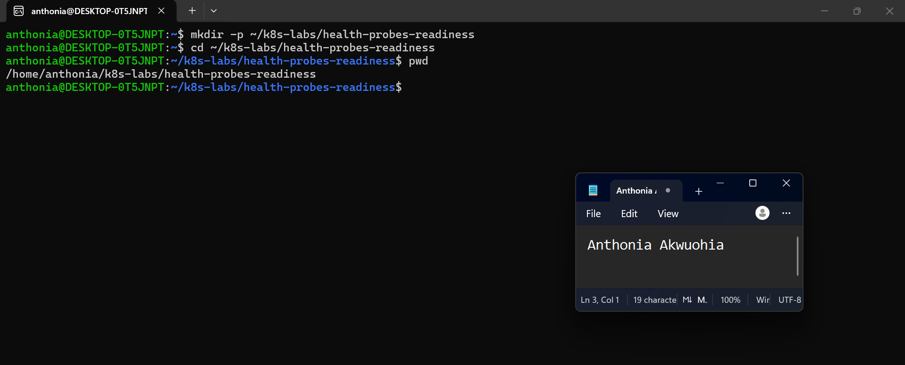

---

### Notes

**1. What is the purpose of a readiness probe?**

A readiness probe checks whether a container is ready to receive traffic. If the probe fails, Kubernetes removes the Pod from the Service's available endpoints until it becomes ready again.

**2. Why is a Pod being Running not always enough to confirm it can serve traffic?**

Running means the Pod's containers have started, but the application may still be initializing, loading data, or experiencing errors. A readiness probe verifies that the application is actually ready to handle requests.

---

# Task 2 — Create a Baseline Deployment Without Probes

## Goal

Create a baseline NGINX Deployment with two replicas and no readiness probe.

### Evidence

#### Screenshot 2 — Completed `00-nginx-deploy-baseline.yaml` manifest

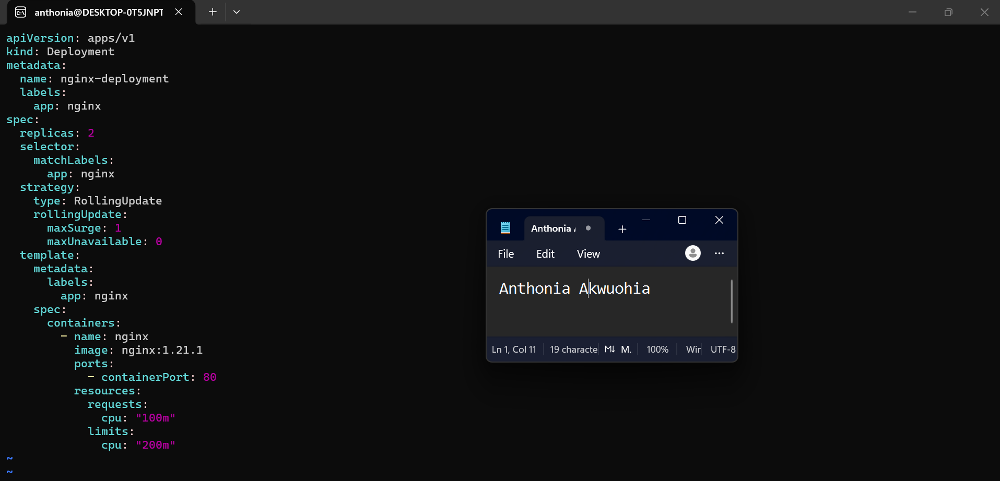
---

#### Screenshot 3 — Output showing a successful rollout and two running NGINX Pods

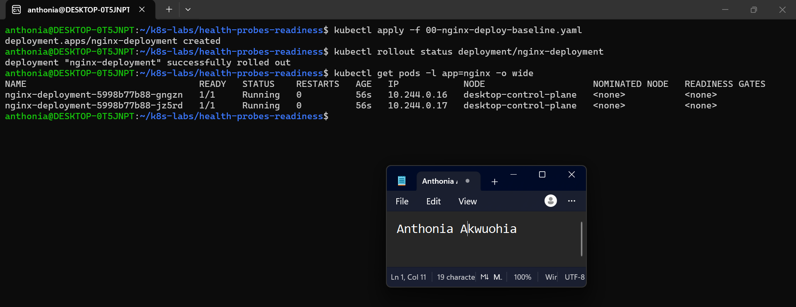

---

#### Screenshot 4 — Relevant output from `kubectl describe deployment nginx-deployment`

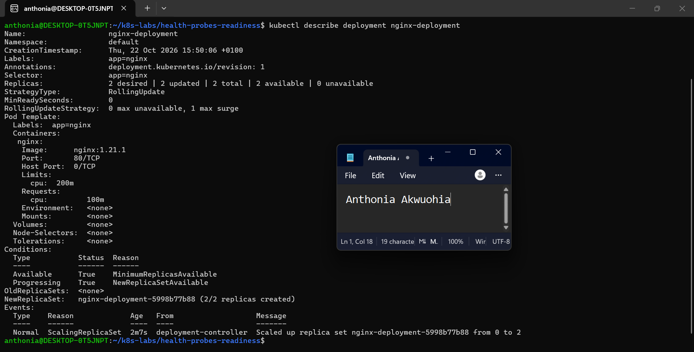

---

### Notes

**1. How many replicas does this Deployment maintain?**

The Deployment maintains 2 replicas of the NGINX Pod.

**2. What does `maxUnavailable: 0` mean during a rolling update?**

It means Kubernetes should not allow any desired replicas to be unavailable during a rolling update. It creates a replacement Pod before removing an existing one, helping maintain application availability.

**3. Is a readiness probe configured in this baseline Deployment?**

No. The baseline Deployment does not have a readiness probe configured. Kubernetes uses its default container readiness behavior until a readiness probe is added.

---

# Task 3 — Add a Readiness Probe

## Goal

Add an HTTP readiness probe so Kubernetes checks whether each NGINX container is ready to accept requests.

### Evidence

#### Screenshot 5 — Completed `01-nginx-deploy-readiness.yaml` manifest showing the readiness probe

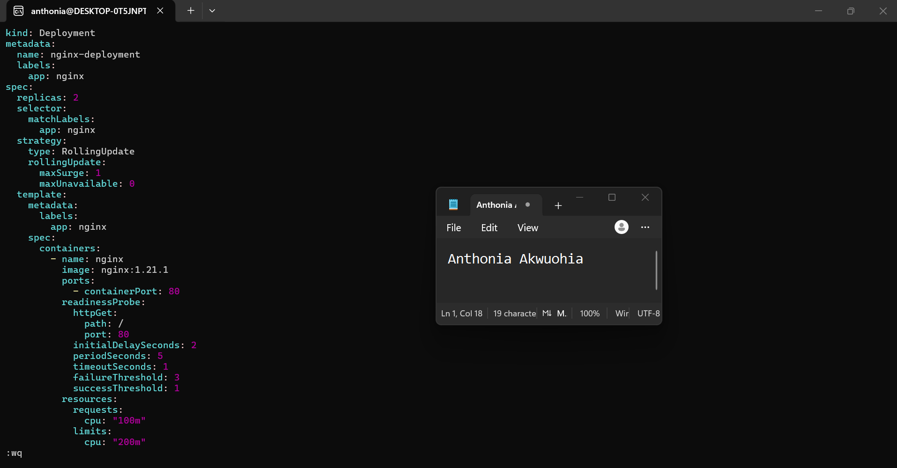

---

#### Screenshot 6 — Output of the successful rollout and ready Pods

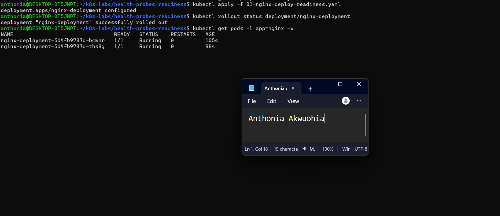

---

#### Screenshot 7 — Pod description showing readiness conditions and readiness probe details

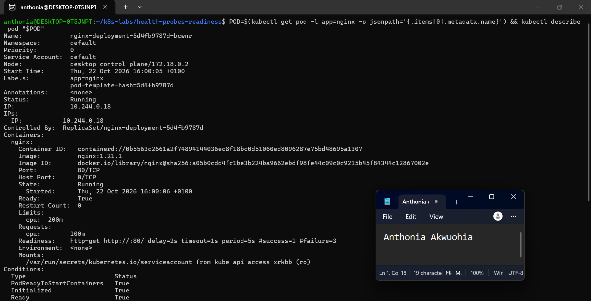

---

### Notes

**1. What path and port does the readiness probe check?**

The readiness probe checks the root path / on port 80 using an HTTP GET request.

**2. What does `initialDelaySeconds: 2` do?**

It tells Kubernetes to wait 2 seconds after the container starts before performing the first readiness probe.

**3. What does `periodSeconds: 5` do?**

It tells Kubernetes to perform the readiness probe every 5 seconds.

**4. What must happen before Kubernetes considers this Pod ready?**

The container must successfully respond to the HTTP GET request on path / at port 80. When the probe succeeds, Kubernetes marks the Pod as ready to receive traffic.

---

# Task 4 — Break and Restore Readiness

## Goal

Intentionally fail the readiness probe, observe the NotReady behavior, and then restore the working probe configuration.

### Evidence

#### Screenshot 8 — `02-nginx-readiness-broken.yaml` showing `/does-not-exist`

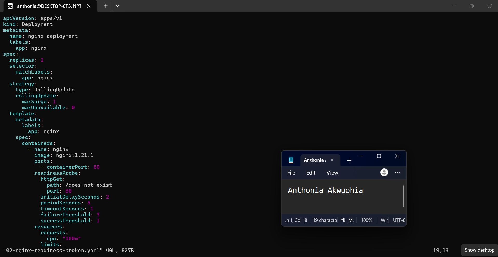
---

#### Screenshot 9 — Output showing the rollout timeout or incomplete rollout

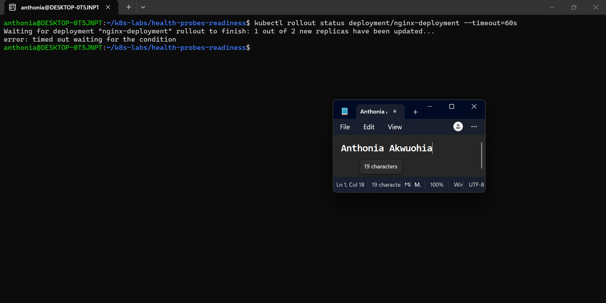

---

#### Screenshot 10 — Pod details showing `Ready: False` or readiness-probe failure events

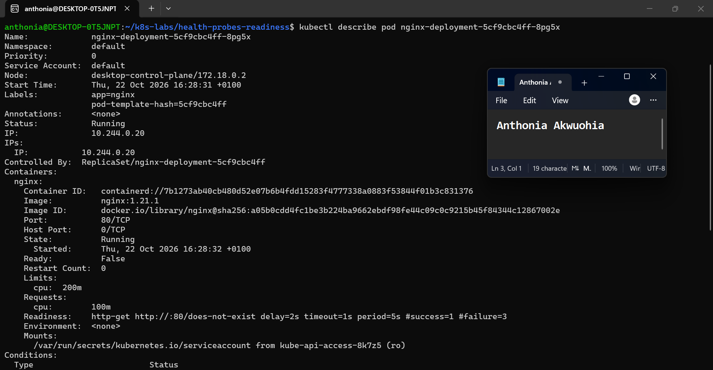

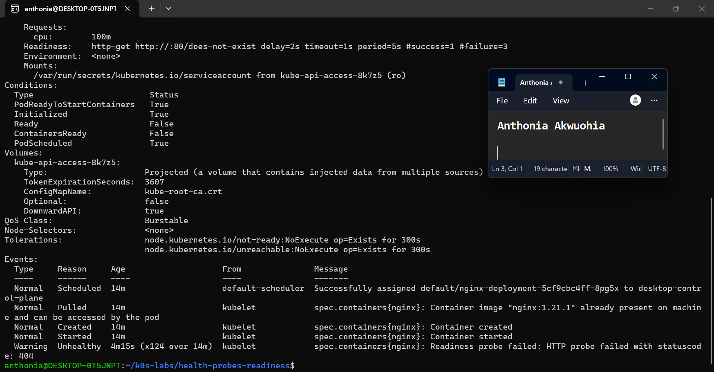
---

#### Screenshot 11 — Output showing successful rollout and ready Pods after the fix

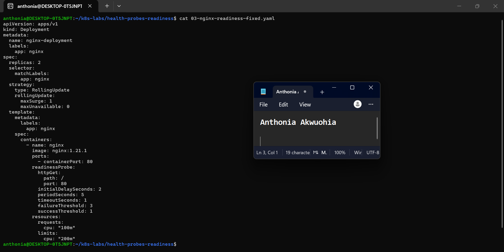

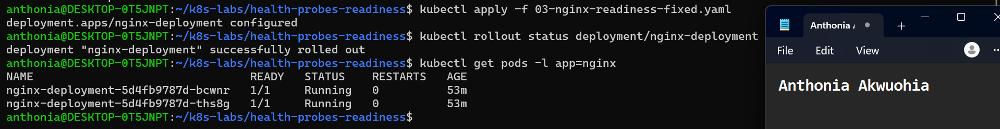
---

### Notes

**1. Why did the readiness probe fail?**

The readiness probe failed because its path was changed from / to /does-not-exist. NGINX returned HTTP 404 Not Found because the requested path did not exist.

**2. What happened to the Pod readiness status?**

The new Pod's readiness status changed to Ready: False, and ContainersReady was also False. Although the container was running, Kubernetes did not consider it ready to receive traffic.

**3. Why did the rollout fail to complete?**

The rollout could not complete because the new Pod failed its readiness probe. The maxUnavailable: 0 setting prevented Kubernetes from removing the existing available Pods before their replacements became ready.

**4. How did you restore the Deployment successfully?**

I copied the original working readiness manifest into 03-nginx-readiness-fixed.yaml, restored the probe path to /, and applied the fixed manifest. The rollout completed successfully, and both NGINX Pods returned to 1/1 Running.

---

# Task 5 — See How Readiness Protects Rolling Updates

## Goal

Observe how readiness prevents a bad new Pod from replacing healthy Pods during a rolling update.

### Evidence

#### Screenshot 12 — Successful update command and rollout status

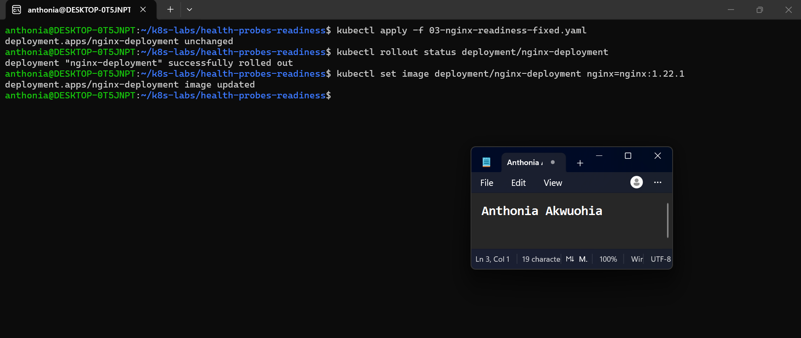
---

#### Screenshot 13 — ReplicaSets and Pods after the successful rolling update

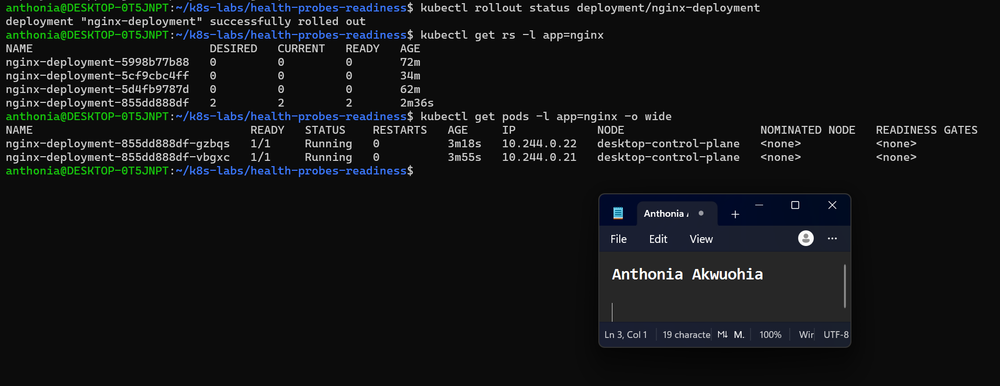

---

#### Screenshot 14 — Completed `04-readiness-broken-patch.yaml`

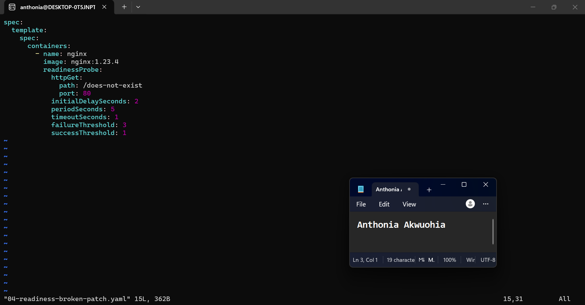

---

#### Screenshot 15 — Output showing the expected stalled rollout or timeout

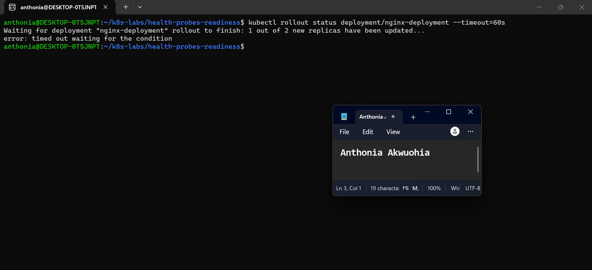
---

#### Screenshot 16 — Deployment or Pod output showing the effect of the broken readiness probe

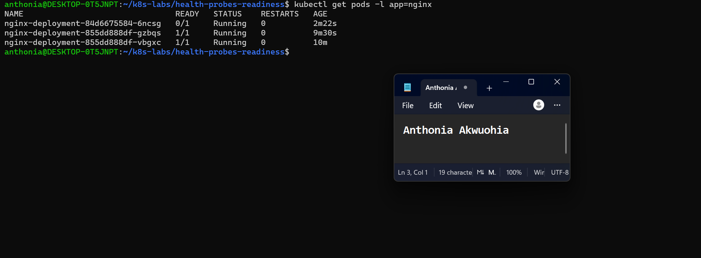

---

#### Screenshot 17 — Successful rollout status after restoring the fixed configuration

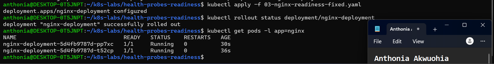
---

### Notes

**1. What happened during the successful rolling update?**

Kubernetes gradually replaced the old NGINX Pods with new Pods running nginx:1.22.1. The new Pods passed their readiness probes, and the rollout completed successfully.

**2. Why did Kubernetes create a new ReplicaSet?**

Kubernetes created a new ReplicaSet because the Deployment's Pod template changed when the NGINX image was updated. Each new Pod template revision is managed by a new ReplicaSet.

**3. Why were the new Pods unable to replace the existing healthy Pods after readiness was broken?**

The new Pods failed their readiness probes because the path /does-not-exist returned HTTP 404 Not Found. Kubernetes therefore considered them NotReady and did not treat them as available replacements for the healthy Pods.

**4. How does `maxUnavailable: 0` protect availability during this rollout?**

It prevents Kubernetes from reducing the number of available replicas below the desired count during the rolling update. With two desired replicas, Kubernetes preserves the two healthy existing Pods while waiting for the new Pods to pass their readiness probes.

---

# Task 6 — Share Your Readiness-Probe Learning on LinkedIn

## Goal

Share what you learned about Kubernetes readiness probes and how they protect rolling updates.

### Evidence

#### Screenshot 18 — Published LinkedIn post

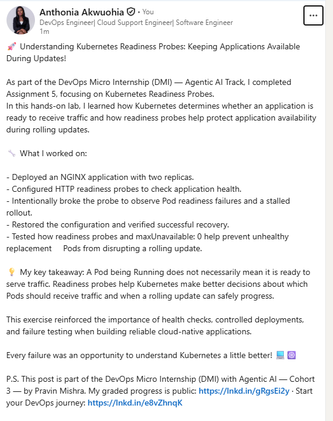

#### Linkedin post link

https://www.linkedin.com/posts/anthonia-akwuohia-5b00681b0_devops-kubernetes-cloudnative-share-7519059648159703040-qINh/?utm_source=share&utm_medium=member_desktop&rcm=ACoAADEhX1QBTHiW-kQPmKjn3MVixQzj4IzJO1Q

---

# Submission Instructions

- Add all required screenshots numbered 1–18.
- Ensure your full name is visible in required screenshots.
- Use clear, readable screenshots showing the relevant manifest or output.
- Include the completed baseline and readiness-probe manifests in your repository.
- Answer all Notes questions for Tasks 1–5 in your own words.
- Include evidence of the intentional readiness failure and successful recovery.
- Do not expose tokens, passwords, kubeconfig files, account IDs, or other sensitive information.

---

# Completion Checklist

- [ ] Learning cluster confirmed and previous assignment resources removed where applicable
- [ ] Readiness-probe lab directory created (Screenshot 1)
- [ ] Baseline Deployment created successfully (Screenshot 2)
- [ ] Two baseline Pods running and successful rollout verified (Screenshot 3)
- [ ] Baseline Deployment details reviewed (Screenshot 4)
- [ ] Readiness probe added successfully (Screenshot 5)
- [ ] Successful readiness rollout verified (Screenshot 6)
- [ ] Pod readiness conditions and probe details inspected (Screenshot 7)
- [ ] Broken readiness configuration created (Screenshot 8)
- [ ] Stalled rollout or timeout observed (Screenshot 9)
- [ ] NotReady status or readiness-probe failure events captured (Screenshot 10)
- [ ] Working readiness configuration restored (Screenshot 11)
- [ ] Successful image update completed (Screenshot 12)
- [ ] ReplicaSets and Pods inspected after the update (Screenshot 13)
- [ ] Broken-readiness patch created (Screenshot 14)
- [ ] Stalled rollout observed after the patch (Screenshot 15)
- [ ] Effect of broken readiness captured (Screenshot 16)
- [ ] Final recovery completed (Screenshot 17)
- [ ] LinkedIn post published (Screenshot 18)
- [ ] Notes for Tasks 1–5 completed
- [ ] Required manifests included
- [ ] All screenshots are clear and readable
- [ ] No sensitive data exposed

---

## 📌 About DMI & CloudAdvisory

DevOps Micro Internship (DMI) is a project-based DevOps program run by Pravin Mishra (The CloudAdvisory) focused on real-world execution, systems thinking, and career readiness.

It helps learners build strong DevOps foundations with hands-on experience.

---

## 📌 Resources

- 🌐 DMI Official Website: https://dmi.pravinmishra.com?utm_source=github&utm_medium=readme  
- 🎓 University: https://university.pravinmishra.com?utm_source=github&utm_medium=readme  
- 💬 Discord Community: https://discord.pravinmishra.com?utm_source=github&utm_medium=readme  
- 📝 Blog: https://dmi.pravinmishra.com/blog?utm_source=github&utm_medium=readme  
- ▶️ YouTube Playlist: https://www.youtube.com/playlist?list=PLFeSNDtI4Cho  
- 🔗 Pravin Mishra (LinkedIn): https://www.linkedin.com/in/pravin-mishra-aws-trainer/  
- 🏢 CloudAdvisory (LinkedIn): https://www.linkedin.com/company/thecloudadvisory/

---

*This submission is part of DevOps Micro Internship (DMI) — Agentic AI Track.*
