# Assignment 6 — Kubernetes Health Probes (Liveness)

Part of the DevOps Micro Internship (DMI) with Agentic AI

---

## Purpose

In this assignment, you will configure and test a Kubernetes liveness probe. You will create a baseline NGINX Deployment, add an HTTP liveness probe, intentionally make it fail, observe container restarts, and restore the working configuration.

---

# Task 0 — Prepare the Lab Environment

## Goal

Confirm that you are connected to your learning cluster and remove the previous HPA and NGINX Deployment before starting this lab.

No screenshot or written notes are required for this pre-check.

---

# Task 1 — Set Up Your Lab Directory

## Goal

Create and enter a dedicated directory for the liveness-probe lab.

### Evidence

#### Screenshot 1 — Terminal showing that you are working inside `~/k8s-labs/health-probes-liveness`

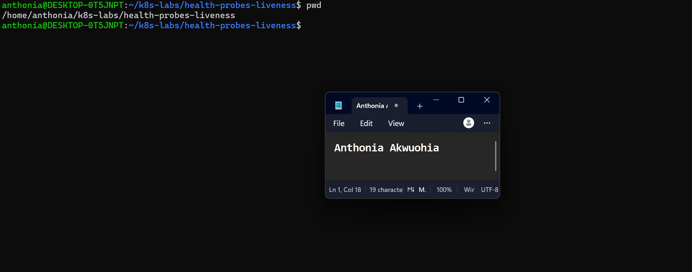

---

### Notes

**1. What problem does a liveness probe solve?**

A liveness probe detects when a container is stuck or unhealthy and cannot recover on its own. Kubernetes can automatically restart the container when the liveness probe fails repeatedly, helping the application recover without manual intervention.

**2. What is the key difference between a readiness probe and a liveness probe?**

A readiness probe checks whether a container is ready to receive traffic. If it fails, Kubernetes removes the Pod from the Service's available endpoints until it becomes ready again.

A liveness probe checks whether a container is still functioning properly. If it fails repeatedly, Kubernetes restarts the container.

---

# Task 2 — Create a Baseline Deployment Without Probes

## Goal

Create a baseline NGINX Deployment with two replicas and no health probes.

### Evidence

#### Screenshot 2 — Completed `00-nginx-deploy-baseline.yaml` manifest

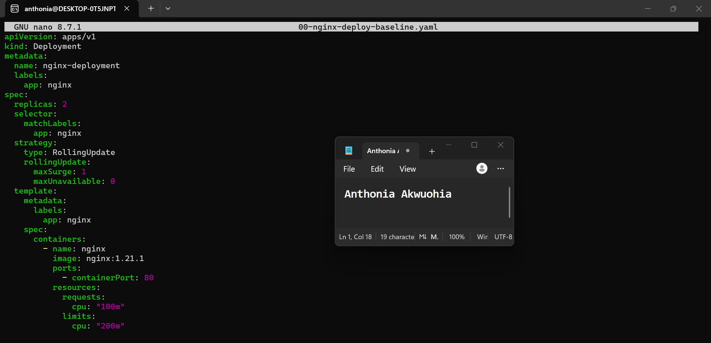

---

#### Screenshot 3 — Output showing a successful rollout and two running NGINX Pods

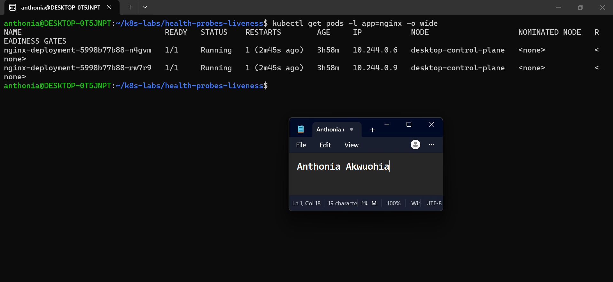

---

#### Screenshot 4 — Relevant output from `kubectl describe deployment nginx-deployment`

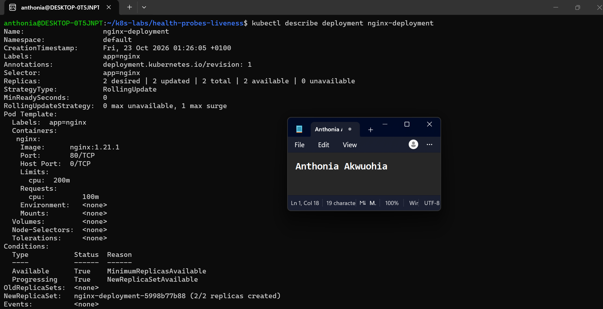

---

### Notes

**1. How many replicas does this Deployment maintain?**

The Deployment maintains 2 replicas of the NGINX Pod to provide multiple instances of the application.

**2. Are any health probes configured in the baseline Deployment?**

No. The baseline Deployment has no readiness or liveness probes configured. Kubernetes runs the containers, but it does not yet use these probes to check application readiness or health.

**3. Why is a baseline useful before adding a liveness probe?**

A baseline provides a starting point for comparison. It helps us observe the application's normal behaviour before adding a liveness probe, making it easier to identify how the probe detects an unhealthy container and triggers an automatic restart when necessary.

---

# Task 3 — Add a Liveness Probe

## Goal

Add an HTTP liveness probe so Kubernetes can periodically check whether the NGINX container is still responsive.

### Evidence

#### Screenshot 5 — Completed `01-nginx-deploy-liveness.yaml` manifest showing the liveness probe

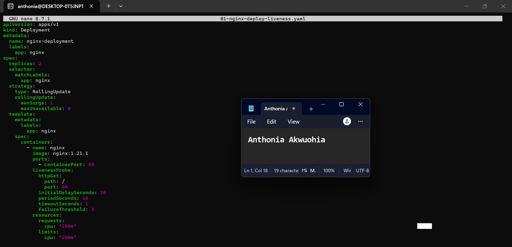

---

#### Screenshot 6 — Output showing successful rollout and running Pods

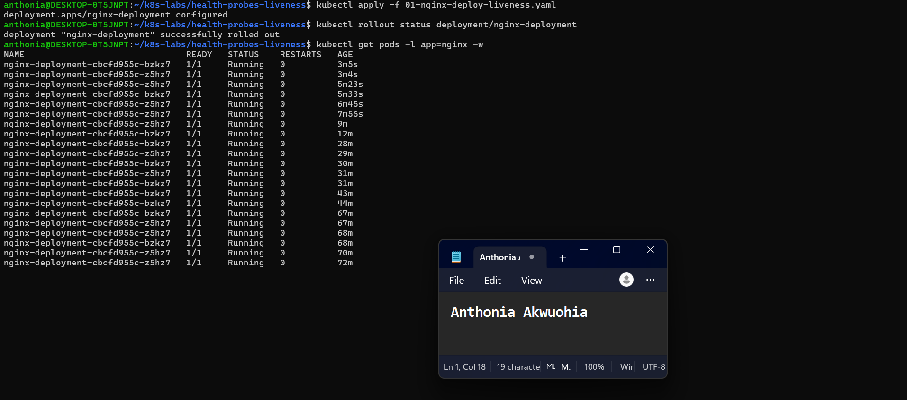

---

#### Screenshot 7 — Pod description showing liveness-probe details

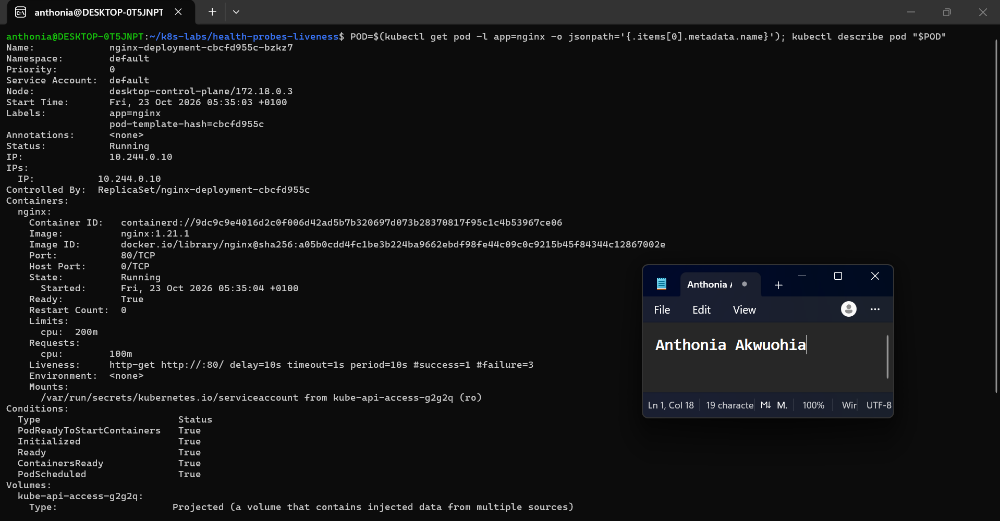

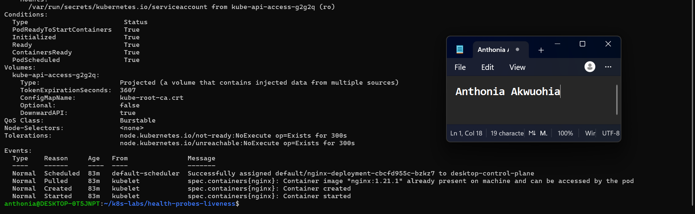

---

### Notes

**1. What path and port does the liveness probe check?**

The liveness probe sends an HTTP GET request to the / path on port 80 to check whether the NGINX container is responsive.

**2. What does `initialDelaySeconds: 10` do?**

It waits 10 seconds after the container starts before performing the first liveness check.

**3. What does `failureThreshold: 3` mean?**

Kubernetes restarts the container if the liveness probe fails three consecutive times, subject to the configured probe settings.

**4. Does a successful liveness probe control whether a Pod receives traffic? Explain briefly.**

No. A liveness probe determines whether a container should be restarted if it becomes unhealthy. A readiness probe determines whether a Pod is ready to receive traffic. Since this Deployment has no readiness probe configured, the liveness probe alone does not control traffic eligibility.

---

# Task 4 — Trigger and Observe a Liveness Restart

## Goal

Intentionally make the liveness probe fail and observe Kubernetes restart the unhealthy container.

### Evidence

#### Screenshot 8 — `02-nginx-liveness-broken.yaml` showing `/does-not-exist`

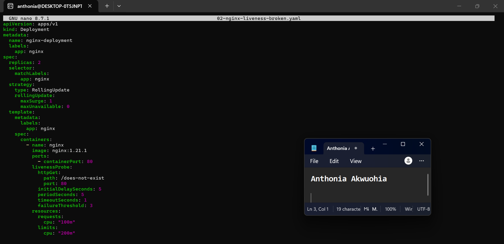 

---

#### Screenshot 9 — Pod output showing an increased RESTARTS count

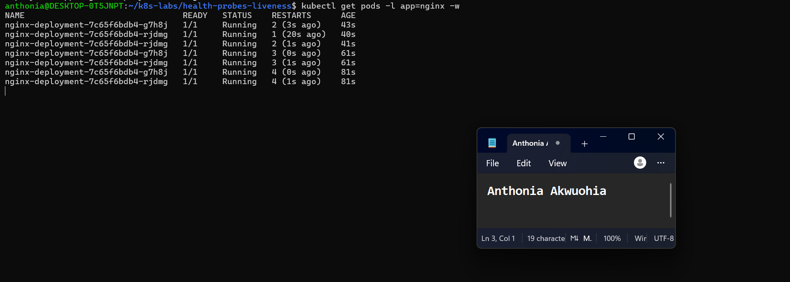

---

#### Screenshot 10 — Pod description showing liveness-probe failure events or restart details

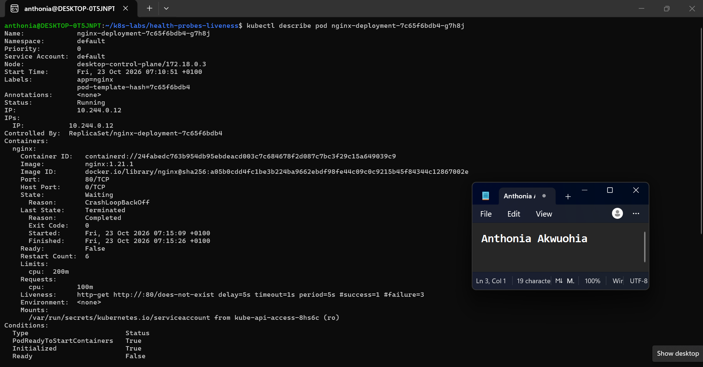

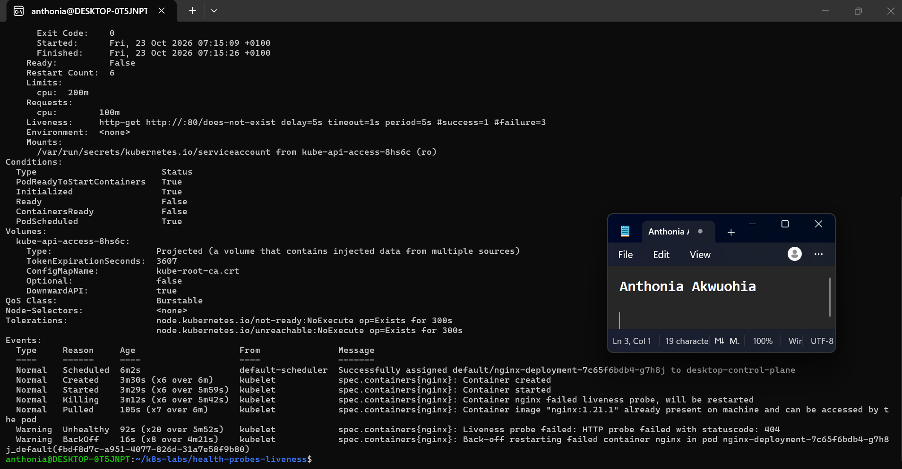

---

#### Screenshot 11 — Output showing stable running Pods after applying the fixed configuration

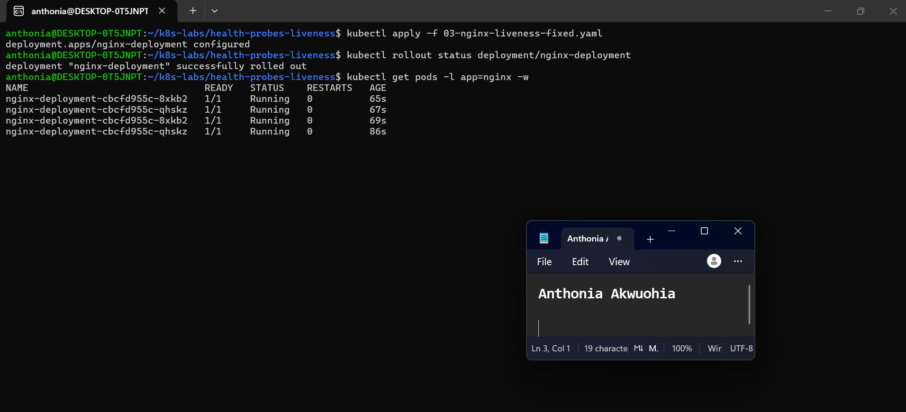

---

### Notes

**1. Why did the liveness probe fail?**

The liveness probe failed because it sent an HTTP GET request to /does-not-exist on port 80. NGINX returned HTTP 404 Not Found, causing repeated liveness-probe failures.

**2. What happened after Kubernetes detected repeated liveness-probe failures?**

Kubernetes restarted the unhealthy containers after the liveness probe failed repeatedly. The Pod events showed Liveness probe failed, Killing, and BackOff, and the Pods eventually entered CrashLoopBackOff.

**3. What does the RESTARTS column prove?**

The RESTARTS column showed increasing counts, confirming that Kubernetes restarted the NGINX containers after repeated liveness-probe failures.

**4. How did you restore the Deployment to a stable state?**

I copied the working configuration from 01-nginx-deploy-liveness.yaml into 03-nginx-liveness-fixed.yaml and applied it. The fixed manifest restored the probe path to / on port 80. The rollout completed successfully, and the Pods returned to a stable running state.

---

# Task 5 — Optional: Observe a Restart Loop

## Goal

Observe why overly aggressive or incorrectly configured liveness probes can create restart loops.

Complete this section only if you attempt Task 5. Otherwise, mark it as “Not attempted.”

**Task status:** Completed / Not attempted

### Evidence

#### Optional Screenshot — Pod output showing the RESTARTS count increasing during the restart-loop observation

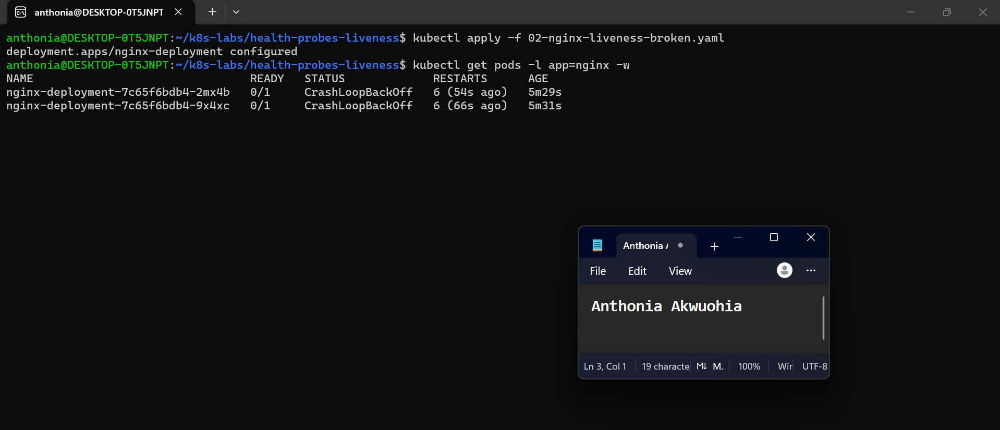

No specific restart count or CrashLoopBackOff status is required.

---

### Notes — Answer Only If Attempted

**1. What is a restart loop?**

A restart loop occurs when a container repeatedly fails and Kubernetes keeps restarting it. In this task, the broken liveness probe caused repeated restarts, eventually placing the NGINX Pods in CrashLoopBackOff.

**2. Why can an aggressive liveness probe be harmful?**

An overly aggressive or incorrectly configured liveness probe can restart a healthy application unnecessarily. Repeated restarts interrupt service, waste resources, and may prevent the application from recovering properly.

**3. Why should liveness checks be lightweight and carefully tuned?**

Liveness checks should be lightweight to avoid consuming excessive resources. Their timing and failure thresholds should allow enough time for normal startup and temporary delays while still detecting genuinely unhealthy containers.

---

# Task 6 — Share Your Liveness-Probe Learning on LinkedIn

## Goal

Share what you learned about Kubernetes liveness probes, container restarts, and the difference between readiness and liveness.

### Evidence

#### Screenshot 12 — Published LinkedIn post

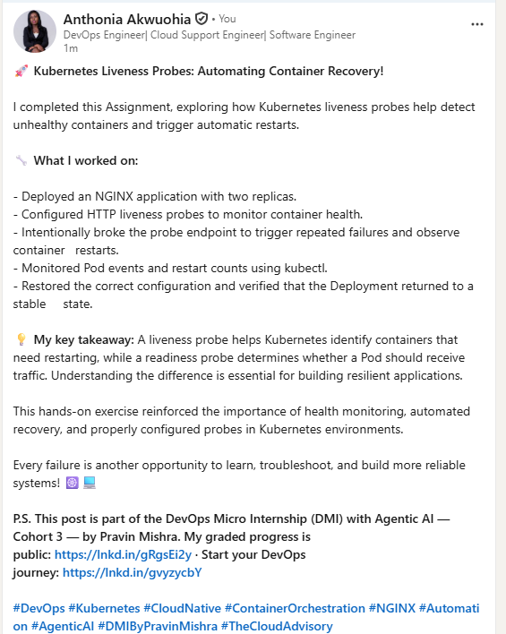

#### Linkedin post URL

https://www.linkedin.com/posts/anthonia-akwuohia-5b00681b0_devops-kubernetes-cloudnative-share-7519289570341978112-cGYl/?utm_source=share&utm_medium=member_desktop&rcm=ACoAADEhX1QBTHiW-kQPmKjn3MVixQzj4IzJO1Q

---

# Submission Instructions

- Add all required screenshots numbered 1–12.
- Include the optional Task 5 screenshot only if you attempt that task.
- Ensure your full name is visible in required screenshots.
- Use clear, readable screenshots showing the relevant manifest or output.
- Include the completed baseline and liveness-probe manifests in your repository.
- Answer all Notes questions for Tasks 1–4 in your own words.
- If you attempt Task 5, complete its Notes and restore the working configuration afterward.
- Do not expose tokens, passwords, kubeconfig files, account IDs, or other sensitive information.

---

# Completion Checklist

- [ ] Learning cluster confirmed and previous assignment resources removed where applicable
- [ ] Liveness-probe lab directory created (Screenshot 1)
- [ ] Baseline Deployment manifest completed (Screenshot 2)
- [ ] Successful rollout and two baseline Pods verified (Screenshot 3)
- [ ] Baseline Deployment details reviewed (Screenshot 4)
- [ ] Liveness probe added successfully (Screenshot 5)
- [ ] Successful liveness-probe rollout verified (Screenshot 6)
- [ ] Liveness-probe details inspected (Screenshot 7)
- [ ] Broken liveness configuration created (Screenshot 8)
- [ ] Increased container restart count observed (Screenshot 9)
- [ ] Liveness-probe failure events or restart details captured (Screenshot 10)
- [ ] Working liveness configuration restored and stable Pods verified (Screenshot 11)
- [ ] Optional Task 5 evidence and Notes completed, if attempted
- [ ] Working configuration restored after Task 5, if attempted
- [ ] LinkedIn post published (Screenshot 12)
- [ ] Notes for Tasks 1–4 completed
- [ ] Required manifests included
- [ ] All required screenshots are clear and readable
- [ ] No sensitive data exposed

---

## 📌 About DMI & CloudAdvisory

DevOps Micro Internship (DMI) is a project-based DevOps program run by Pravin Mishra (The CloudAdvisory) focused on real-world execution, systems thinking, and career readiness.

It helps learners build strong DevOps foundations with hands-on experience.

---

## 📌 Resources

- 🌐 DMI Official Website: https://dmi.pravinmishra.com?utm_source=github&utm_medium=readme  
- 🎓 University: https://university.pravinmishra.com?utm_source=github&utm_medium=readme  
- 💬 Discord Community: https://discord.pravinmishra.com?utm_source=github&utm_medium=readme  
- 📝 Blog: https://dmi.pravinmishra.com/blog?utm_source=github&utm_medium=readme  
- ▶️ YouTube Playlist: https://www.youtube.com/playlist?list=PLFeSNDtI4Cho  
- 🔗 Pravin Mishra (LinkedIn): https://www.linkedin.com/in/pravin-mishra-aws-trainer/  
- 🏢 CloudAdvisory (LinkedIn): https://www.linkedin.com/company/thecloudadvisory/

---

*This submission is part of DevOps Micro Internship (DMI) — Agentic AI Track.*
