# Assignment 7 — Kubernetes Services (ClusterIP)

Part of the DevOps Micro Internship (DMI) with Agentic AI

---

## Purpose

In this assignment, you will create and test a Kubernetes ClusterIP Service. You will connect it to a healthy NGINX Deployment, access it using DNS and its ClusterIP, break and restore its selector, and observe how readiness affects Service routing.

---

# Task 0 — Prepare the Lab Environment

## Goal

Confirm your learning-cluster context and remove previous lab resources where applicable before starting this assignment.

No screenshot or written notes are required for this pre-check.

---

# Task 1 — Set Up Your Lab Directory

## Goal

Create and enter a dedicated directory for the ClusterIP Service lab.

### Evidence

#### Screenshot 1 — Terminal showing that you are working inside `~/k8s-labs/services/clusterip`

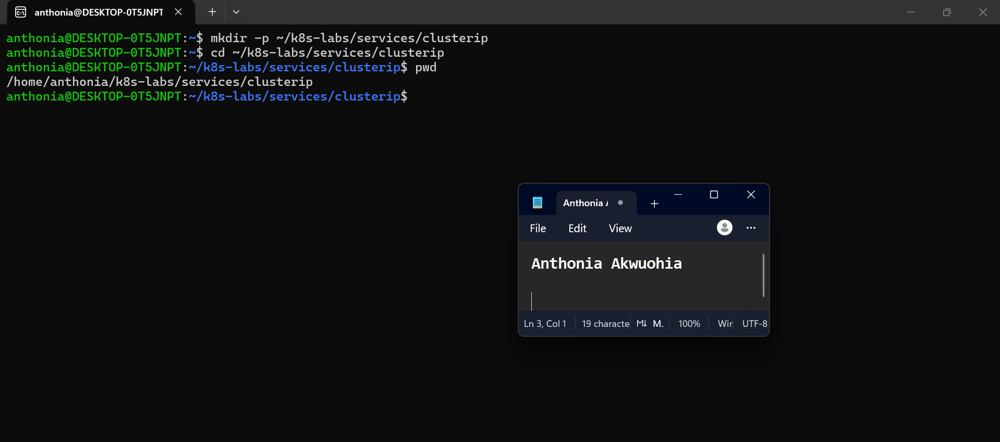

---

### Notes

**1. Why is it not reliable to communicate with an application using a Pod IP address?**

Pod IP addresses are temporary and can change when Pods are restarted, recreated, or rescheduled. Therefore, using a Pod IP directly is unreliable for consistent application access.

**2. What Kubernetes resource provides a stable internal address for a group of Pods?**

A Kubernetes Service, specifically a ClusterIP Service, provides a stable internal IP address and DNS name for accessing a group of Pods. It forwards traffic to eligible Pods selected by labels.

---

# Task 2 — Create a Healthy NGINX Deployment

## Goal

Create an NGINX Deployment with labels, readiness probes, and liveness probes that can act as the backend for a Service.

### Evidence

#### Screenshot 2 — Completed `00-nginx-deploy.yaml` manifest

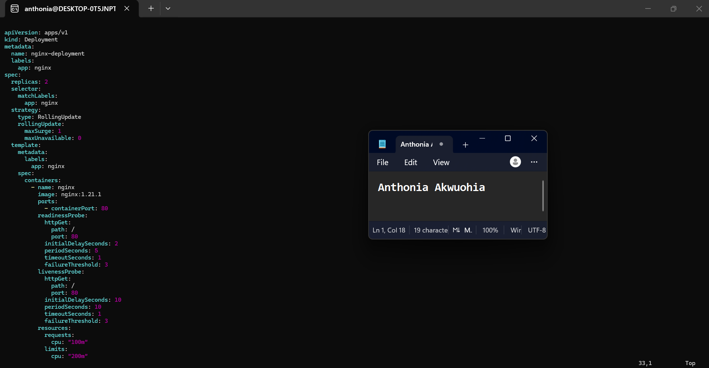

---

#### Screenshot 3 — Output showing successful rollout and two ready NGINX Pods

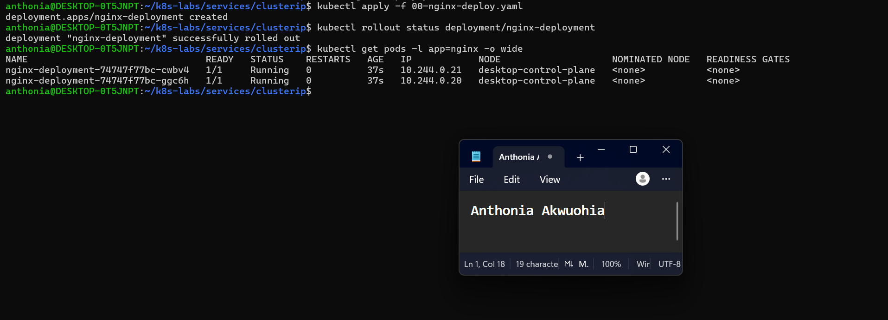

---

### Notes

**1. Which label will the Service use to find these Pods?**

The Service will use the label app: nginx to select the NGINX Pods.

**2. Why is readiness important before connecting Pods to a Service?**

Readiness ensures that only Pods that are ready to handle requests receive traffic through the Service. This helps prevent requests from being sent to unhealthy or not-yet-ready application instances.

**3. What port does the NGINX container listen on?**

The NGINX container listens on port 80 (HTTP).

---

# Task 3 — Create a ClusterIP Service

## Goal

Create a stable internal Service that routes traffic to the NGINX Pods.

### Evidence

#### Screenshot 4 — Completed `01-nginx-svc-clusterip.yaml` manifest

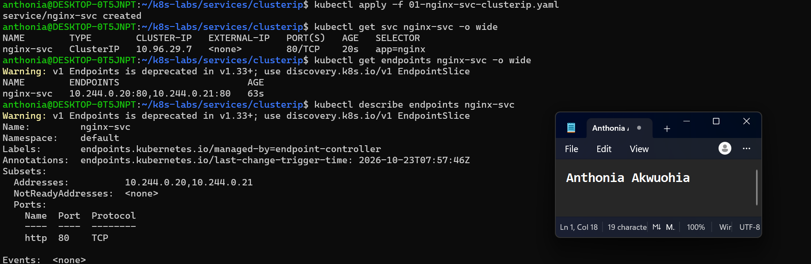

---

#### Screenshot 5 — Output showing the ClusterIP Service, endpoints, or EndpointSlices

---

### Notes

**1. What is the purpose of a ClusterIP Service?**

A ClusterIP Service provides a stable internal IP address and DNS name for accessing a group of Pods within a Kubernetes cluster. It distributes traffic to eligible backend Pods without exposing the application directly to external networks.

**2. What is the difference between `port` and `targetPort`?**

- port is the port exposed by the Service for clients to access.
- targetPort is the port on the backend Pods to which the Service forwards traffic.
In this lab, both are set to port 80.

**3. Why must the Service selector match the Pod labels?**

The selector app: nginx must match the labels on the NGINX Pods so Kubernetes can identify the correct backends and register them as Service endpoints. If the selector does not match, the Service will have no eligible endpoints.

**4. What information do EndpointSlices contain?**

EndpointSlices contain backend endpoint information, including Pod IP addresses, ports, address type, and readiness, serving, and terminating conditions. Kubernetes uses them to track the endpoints available behind a Service.

---

# Task 4 — Access the Service from Inside the Cluster

## Goal

Create a client Pod and access the NGINX Service using DNS and its ClusterIP.

### Evidence

#### Screenshot 6 — Output showing the `tester` Pod running

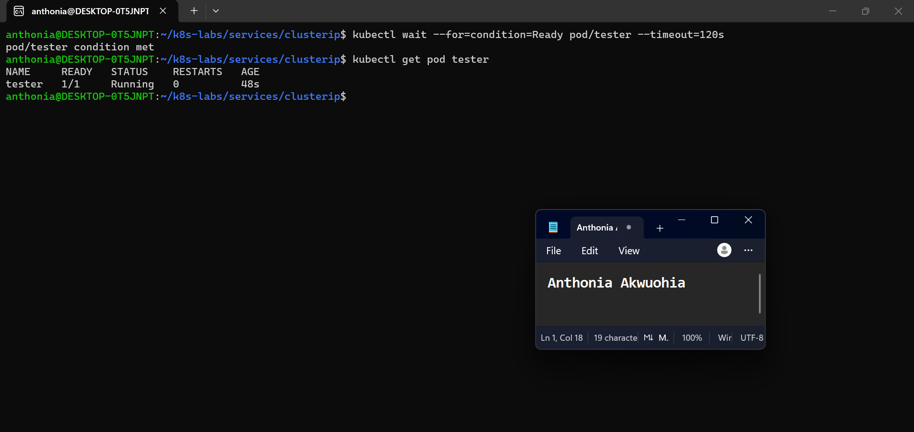

---

#### Screenshot 7 — Successful Service request using DNS name and ClusterIP

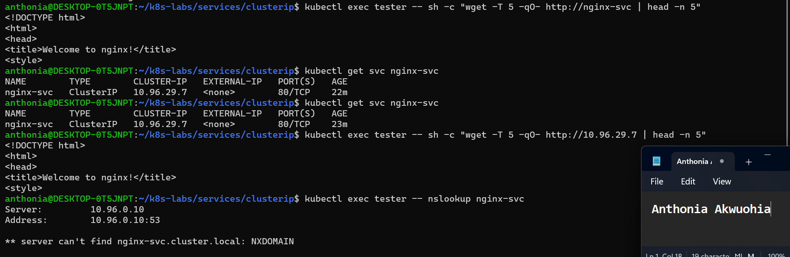

---

#### Screenshot 8 — Successful DNS lookup for the Service

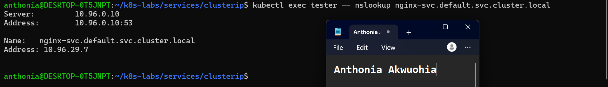

---

### Notes

**1. Why should an application use `nginx-svc` instead of a Pod IP address?**

An application should use nginx-svc because it provides a stable DNS name for accessing the NGINX Service. Pod IP addresses can change when Pods are restarted or recreated, but the Service name remains stable.

**2. What does the DNS name `nginx-svc.default.svc.cluster.local` represent?**

It is the fully qualified domain name (FQDN) of the nginx-svc Service in the default namespace within the Kubernetes cluster. It resolves to the Service's internal ClusterIP address.

**3. Why can the client access the Service even if the backend Pod IPs change?**

The Service provides a stable ClusterIP and DNS name. Kubernetes automatically updates the Service's EndpointSlices when backend Pods change, allowing traffic to reach the current eligible Pods without requiring the client to know their individual IP addresses.

---

# Task 5 — Break and Restore the Label-Selector Contract

## Goal

Break the Service selector, observe that usable endpoints disappear, and then restore the correct selector.

### Evidence

#### Screenshot 9 — `02-nginx-svc-selector-broken.yaml` showing the incorrect selector

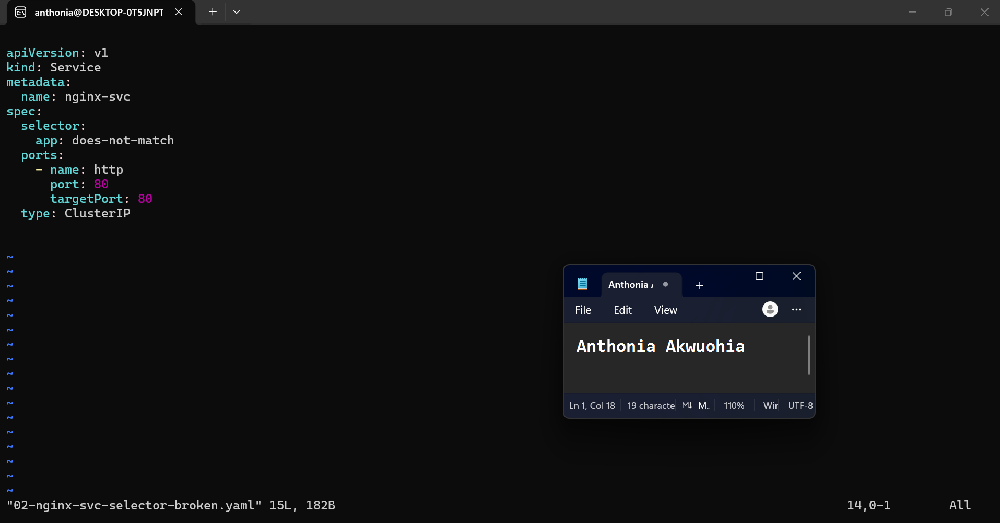

---

#### Screenshot 10 — Empty endpoints or EndpointSlice output after applying the broken selector

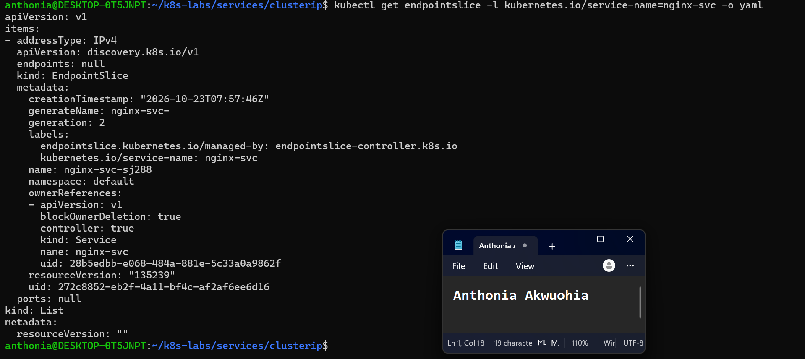

---

#### Screenshot 11 — Failed request output from the `tester` Pod

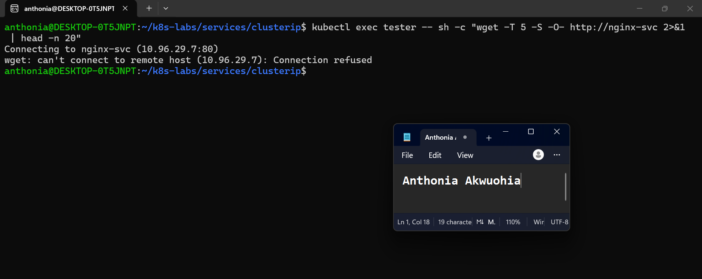

---

#### Screenshot 12 — Restored endpoints and successful Service request

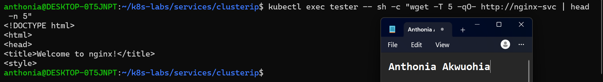

---

### Notes

**1. Why did the Service endpoints become empty?**

The Service endpoints became empty because I changed the Service selector from app: nginx to app: does-not-match. Since this selector did not match the labels on the NGINX Pods, Kubernetes could not register them as backend endpoints.

**2. What caused the request from the client Pod to fail?**

The request from the client Pod (tester) failed because the Service had no matching backend endpoints to forward traffic to. Although the Service's ClusterIP and DNS name still existed, the request returned a Connection refused error because no backend Pods were available.

**3. How did you restore connectivity to the NGINX Pods?**

I restored connectivity by applying the original Service manifest, 01-nginx-svc-clusterip.yaml, which restored the selector to app: nginx. Kubernetes then registered the matching NGINX Pods as endpoints again, and the HTTP request through http://nginx-svc successfully returned the NGINX welcome page.

---

# Task 6 — Observe How Readiness Affects Service Routing

## Goal

Observe how a new Pod that fails readiness is excluded from ready Service backends while the existing healthy Pod continues serving traffic.

### Evidence

#### Screenshot 13 — Output showing the Deployment scaled to one ready Pod

Add your screenshot here.

---

#### Screenshot 14 — Completed `03-readiness-broken.yaml` patch file

Add your screenshot here.

---

#### Screenshot 15 — Output showing the expected incomplete rollout or NotReady Pod

Add your screenshot here.

---

#### Screenshot 16 — EndpointSlice output showing the healthy Pod with `ready: true` and the new NotReady Pod with `ready: false`

Add your screenshot here.

---

#### Screenshot 17 — Service EndpointSlice output showing ready backends after restoring the Deployment

Add your screenshot here.

---

### Notes

**1. Why was the new NotReady Pod excluded from ready Service backends?**

The new Pod was excluded because its readiness probe checked the nonexistent path /does-not-exist, which returned HTTP 404 errors. As a result, Kubernetes marked the Pod as NotReady (ready: false) and excluded it from ready Service backends. The existing healthy Pod remained available to handle requests.

**2. What is the relationship between readiness probes and Service routing?**

Readiness probes determine whether a Pod is ready to receive application traffic. Kubernetes updates the Service's EndpointSlice based on Pod readiness, allowing Services to route traffic to ready backends while excluding NotReady Pods. In this task, the healthy Pod remained a ready endpoint, while the new Pod was marked NotReady.

**3. Why does this behavior protect users from unhealthy application instances?**

This behavior prevents user requests from being routed to application instances that are not ready to serve traffic. It helps maintain application availability and reliability because healthy Pods can continue handling requests while unhealthy or incorrectly configured Pods recover. In this task, the NGINX Service continued returning the welcome page through the healthy Pod despite the failed readiness checks on the replacement Pod.

---

# Task 7 — Share Your ClusterIP Service Learning on LinkedIn

## Goal

Share what you learned about ClusterIP Services, Kubernetes DNS, selectors, and readiness-aware Service routing.

### Evidence

#### Screenshot 18 — Published LinkedIn post

Add your screenshot here.

#### Linkedin post link

https://www.linkedin.com/posts/anthonia-akwuohia-5b00681b0_devops-kubernetes-cloudcomputing-share-7519343001257623552-zAo2/?utm_source=share&utm_medium=member_desktop&rcm=ACoAADEhX1QBTHiW-kQPmKjn3MVixQzj4IzJO1Q

---

# Submission Instructions

- Add all required screenshots numbered 1–18.
- Ensure your full name is visible in required screenshots.
- Use clear, readable screenshots showing the relevant manifest or output.
- Include the completed NGINX Deployment and ClusterIP Service manifests in your repository.
- Answer all Notes questions for Tasks 1–6 in your own words.
- Include evidence of the intentional failures and successful recovery.
- Do not expose tokens, passwords, kubeconfig files, account IDs, or other sensitive information.

---

# Completion Checklist

- [ ] Learning-cluster context confirmed and previous lab resources removed where applicable
- [ ] ClusterIP lab directory created (Screenshot 1)
- [ ] Healthy NGINX Deployment manifest completed (Screenshot 2)
- [ ] Successful rollout and two ready NGINX Pods verified (Screenshot 3)
- [ ] ClusterIP Service manifest completed (Screenshot 4)
- [ ] Service and backend endpoints or EndpointSlices verified (Screenshot 5)
- [ ] Client Pod created and running (Screenshot 6)
- [ ] Service accessed using DNS name and ClusterIP (Screenshot 7)
- [ ] Service DNS resolution verified (Screenshot 8)
- [ ] Broken selector manifest created (Screenshot 9)
- [ ] Empty endpoints observed (Screenshot 10)
- [ ] Failed Service request captured (Screenshot 11)
- [ ] Original selector restored and connectivity verified (Screenshot 12)
- [ ] Deployment scaled to one ready Pod (Screenshot 13)
- [ ] Broken readiness patch created (Screenshot 14)
- [ ] Incomplete rollout or NotReady Pod observed (Screenshot 15)
- [ ] Readiness effect on Service backends verified (Screenshot 16)
- [ ] Deployment restored and ready Service backends verified (Screenshot 17)
- [ ] LinkedIn post published (Screenshot 18)
- [ ] Notes for Tasks 1–6 completed
- [ ] Required manifests included
- [ ] All required screenshots are clear and readable
- [ ] No sensitive data exposed

---

## 📌 About DMI & CloudAdvisory

DevOps Micro Internship (DMI) is a project-based DevOps program run by Pravin Mishra (The CloudAdvisory) focused on real-world execution, systems thinking, and career readiness.

It helps learners build strong DevOps foundations with hands-on experience.

---

## 📌 Resources

- 🌐 DMI Official Website: https://dmi.pravinmishra.com?utm_source=github&utm_medium=readme  
- 🎓 University: https://university.pravinmishra.com?utm_source=github&utm_medium=readme  
- 💬 Discord Community: https://discord.pravinmishra.com?utm_source=github&utm_medium=readme  
- 📝 Blog: https://dmi.pravinmishra.com/blog?utm_source=github&utm_medium=readme  
- ▶️ YouTube Playlist: https://www.youtube.com/playlist?list=PLFeSNDtI4Cho  
- 🔗 Pravin Mishra (LinkedIn): https://www.linkedin.com/in/pravin-mishra-aws-trainer/  
- 🏢 CloudAdvisory (LinkedIn): https://www.linkedin.com/company/thecloudadvisory/

---

*This submission is part of DevOps Micro Internship (DMI) — Agentic AI Track.*
