# Assignment 8 — Kubernetes Services (NodePort)

Part of the DevOps Micro Internship (DMI) with Agentic AI

---

## Purpose

Create a healthy NGINX Deployment, expose it through a NodePort Service, test access using a node IP and NodePort, and observe how the Service behaves when a backend Pod is replaced.

---

# Task 1 — Set Up Your Lab Directory

## Goal

Create and enter a dedicated directory for the NodePort Service lab.

### Evidence

#### Screenshot 1 — Terminal showing that you are working inside `~/k8s-labs/services/nodeport`

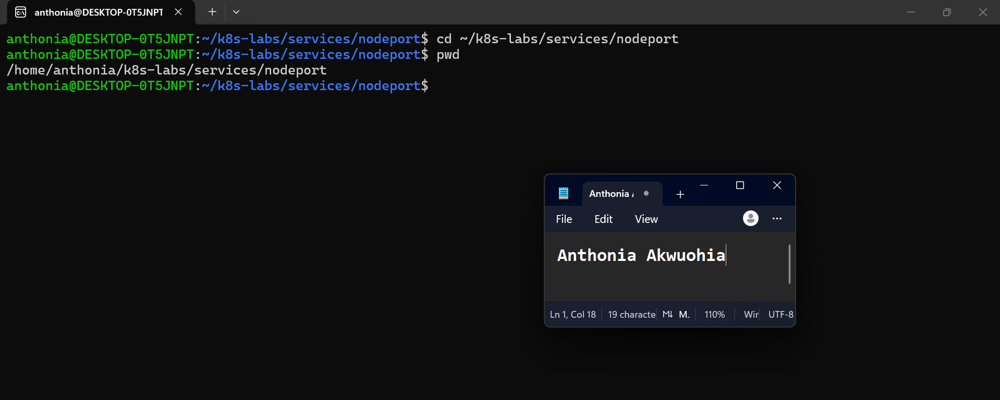

### Notes

**1. What is the difference between ClusterIP and NodePort?**

ClusterIP exposes a Service using an internal IP address that is accessible within the Kubernetes cluster by default. NodePort exposes a Service on a designated port across the cluster's nodes, allowing clients outside the cluster to access the application through a node's IP address and that port, subject to network and firewall configuration.

**2. What does a NodePort Service allow users to do?**

A NodePort Service allows users to access an application running inside a Kubernetes cluster from outside the cluster by connecting to a node's IP address and the assigned NodePort. Kubernetes forwards the traffic to the appropriate backend Pods selected by the Service.

---

# Task 2 — Create a Healthy NGINX Deployment

## Goal

Create a healthy NGINX Deployment that can act as the backend for the NodePort Service.

### Evidence

#### Screenshot 2 — Completed `00-nginx-deploy.yaml` manifest

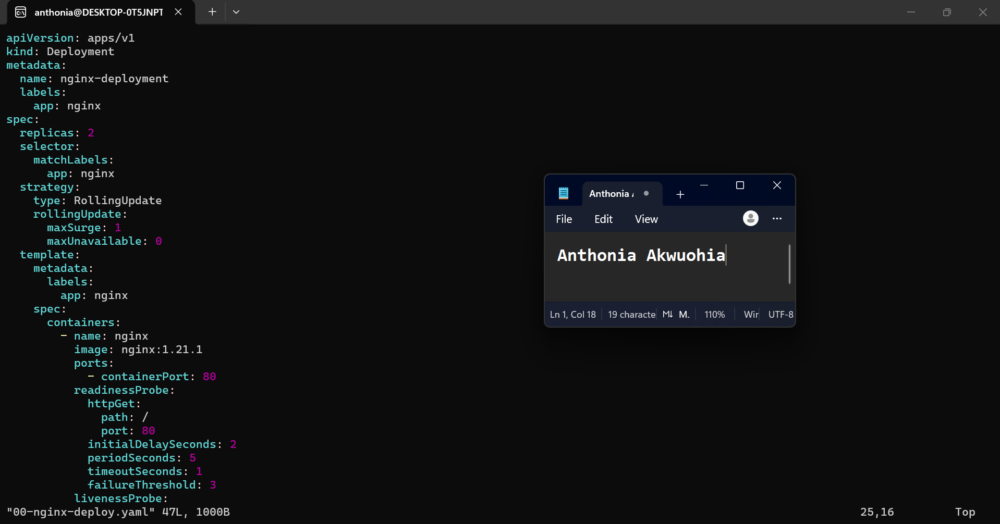

---

#### Screenshot 3 — Output showing successful rollout and two ready NGINX Pods

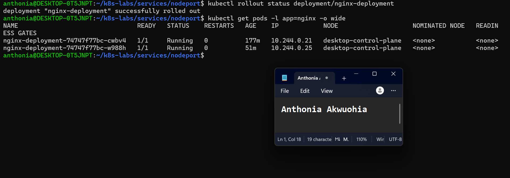

### Notes

**1. Which label will the NodePort Service use to find the NGINX Pods?**

The NodePort Service will use the selector app: nginx to identify the NGINX Pods. The Deployment assigns this label to its Pods, allowing the Service to select the correct backends and route traffic to them.

**2. Why must the Pods be ready before they can receive Service traffic?**

Pods must be ready to ensure they can successfully handle incoming requests. Kubernetes uses readiness probes to determine whether a Pod is ready to serve traffic and excludes NotReady Pods from ready Service backends, helping prevent requests from reaching unhealthy or improperly configured application instances.

**3. What port does the NGINX container listen on?**

The NGINX container listens on port 80, which handles HTTP traffic. The Service can forward incoming requests to this container port using targetPort: 80.

---

# Task 3 — Create the NodePort Service

## Goal

Create a NodePort Service that exposes the NGINX application through a port on every cluster node.

### Evidence

#### Screenshot 4 — Completed `01-nginx-svc-nodeport.yaml` manifest

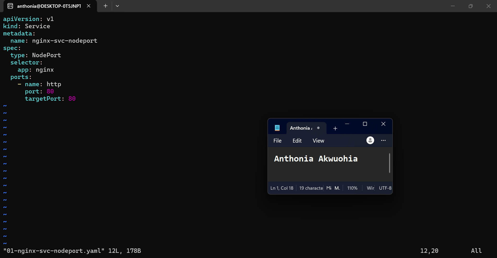

---

#### Screenshot 5 — Output showing the NodePort Service and its endpoints or EndpointSlices

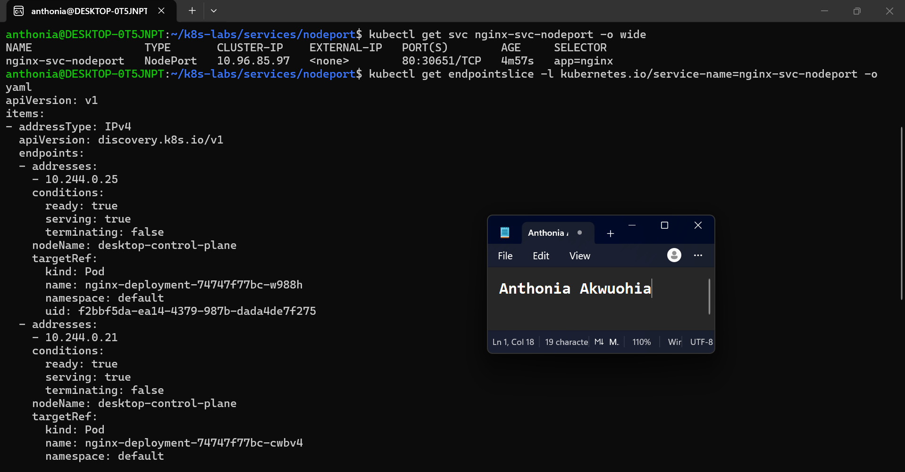

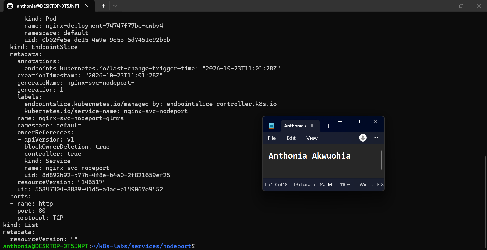

### Notes

**1. What is the purpose of `type: NodePort`?**

type: NodePort exposes the Service through a port on each cluster node, allowing external clients to access the application using a node’s IP address and the assigned NodePort, subject to network and firewall configuration.

**2. What is the difference between `port`, `targetPort`, and `nodePort`?**

port: 80 — The port exposed by the Kubernetes Service.
targetPort: 80 — The port on the NGINX Pods where traffic is forwarded.
nodePort: 30651 — The port opened on each cluster node for accessing the Service externally.

**3. What NodePort was assigned or selected in your environment?**

Kubernetes automatically assigned 30651 to the nginx-svc-nodeport Service.

**4. Why do Service endpoints need ready Pods?**

Ready Pods can receive and process application traffic. Kubernetes uses readiness probes to determine whether Pods are ready and excludes unready Pods from the Service's ready endpoints, helping prevent requests from being sent to Pods that cannot serve them.

---

# Task 4 — Find a Node IP and Test the NodePort

## Goal

Find a reachable node IP and access the NodePort Service.

### Evidence

#### Screenshot 6 — Output of `kubectl get nodes -o wide`

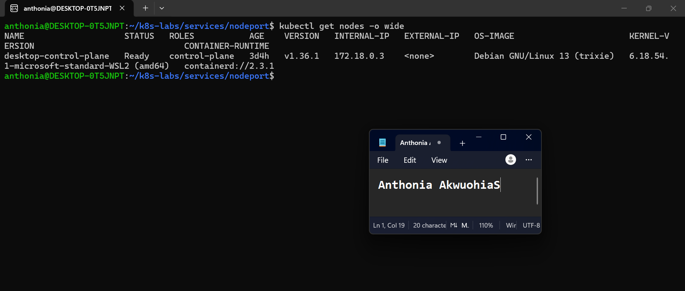

---

#### Screenshot 7 — Output showing the `tester` Pod running

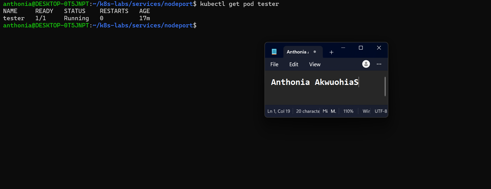

---

#### Screenshot 8 — Successful NodePort response from the laptop or the `tester` Pod

If neither route is supported by your environment, include the failed request output and ready endpoint evidence, and explain the limitation in your Notes.

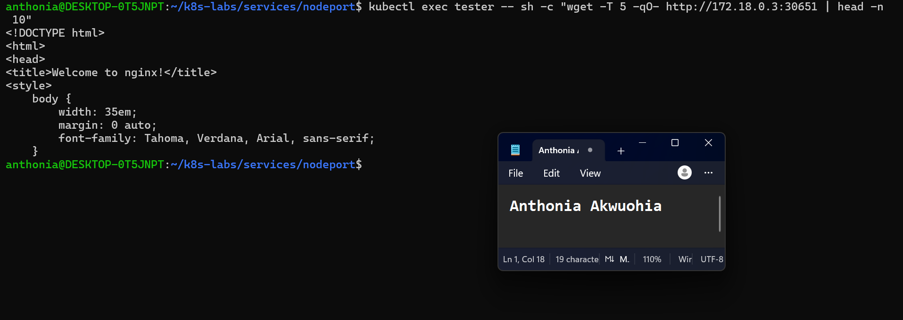

### Notes

**1. Which node IP and NodePort did you test?**

I tested the internal node IP 172.18.0.3 with NodePort 30651. The request from the tester Pod succeeded and returned the default NGINX welcome page.

**2. Was your laptop able to reach the NodePort directly? Explain your result.**

No. The direct request to http://172.18.0.3:30651 timed out after five seconds. The Docker Desktop Kubernetes node uses a managed container network, and its internal IP was not directly reachable from my laptop environment. However, the in-cluster test succeeded.

**3. Why can external NodePort access behave differently in Minikube, kind, Docker Desktop, and cloud clusters?**

No. The direct request to http://172.18.0.3:30651 timed out after five seconds. The Docker Desktop Kubernetes node uses a managed container network, and its internal IP was not directly reachable from my laptop environment. However, the in-cluster test succeeded.

---

# Task 5 — Optional: Test the Label-Selector Contract

## Goal

Break the Service selector, observe that usable endpoints disappear, and restore the correct selector.

Complete the Evidence and Notes below only if you attempted this optional task.

### Evidence

#### Screenshot 9 — `02-nginx-svc-selector-broken.yaml` showing the incorrect selector

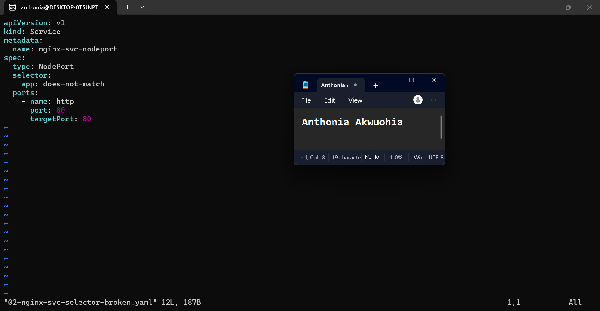

---

#### Screenshot 10 — Empty endpoints or EndpointSlice output after applying the broken selector

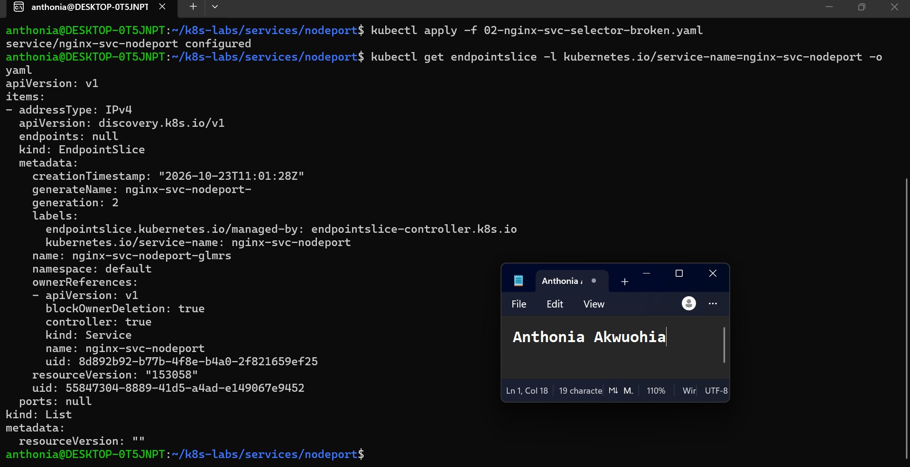

---

#### Screenshot 11 — Restored endpoints or EndpointSlices after applying the original Service manifest

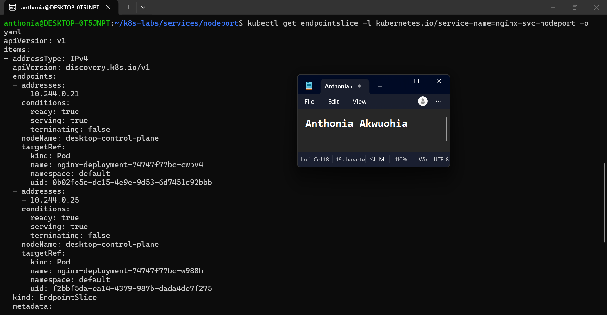

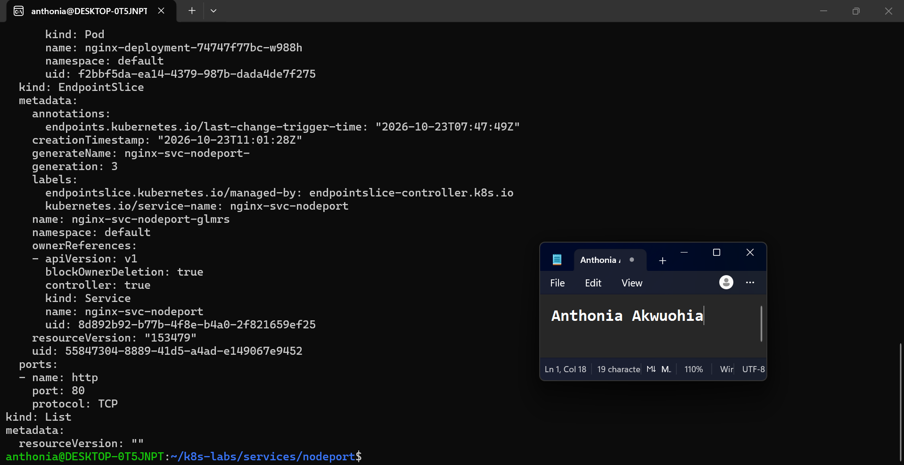

### Notes

**1. Why did the Service endpoints become empty?**

The endpoints became empty because the Service selector was changed to app: does-not-match, which did not match the labels on the NGINX Pods. Kubernetes therefore had no matching backend Pods to route traffic to.

**2. Why is NodePort only useful when matching ready Pods exist?**

NodePort provides an entry point for traffic through a cluster node, but the Service needs matching, ready backend Pods to handle requests. Without usable endpoints, requests cannot reach the application.

**3. How did you restore the backend connectivity?**

I reapplied the original 01-nginx-svc-nodeport.yaml manifest, restoring the selector to app: nginx. I verified that both NGINX Pod endpoints returned with ready: true and tested the NodePort again from the tester Pod. The request successfully returned the NGINX welcome page.

---

# Task 6 — Observe Resilience During Pod Churn

## Goal

Delete one NGINX Pod and observe its replacement while the Service continues routing traffic to available Pods.

### Evidence

#### Screenshot 12 — Output of the Pod deletion command

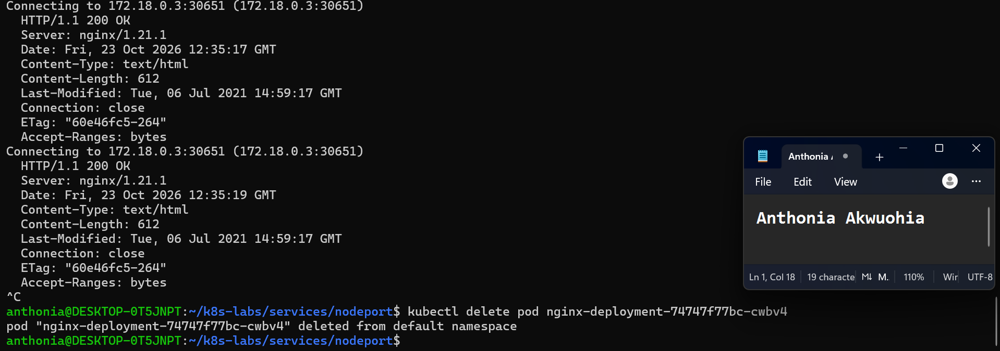

---

#### Screenshot 13 — Output showing the replacement Pod and two running, ready Pods

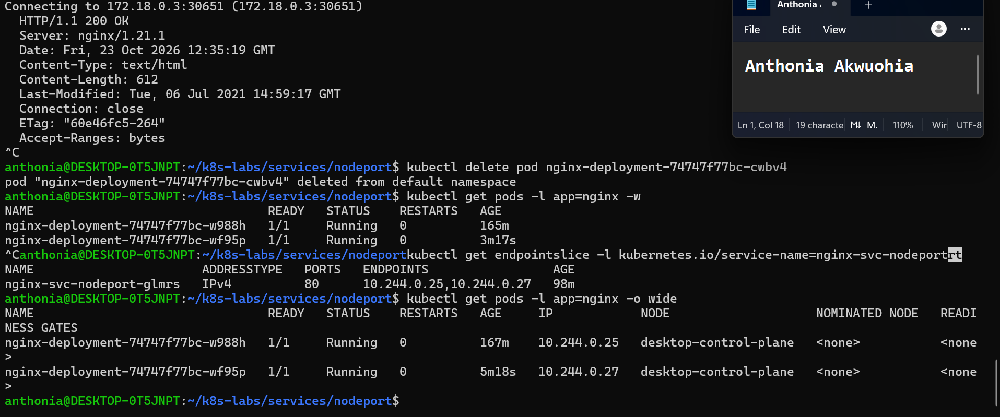

### Notes

**1. What happened after you deleted one Pod?**

When I deleted one NGINX Pod, Kubernetes automatically created a replacement to maintain the Deployment’s desired replica count of two. The remaining Pod stayed healthy while the replacement was created.

**2. Which Kubernetes resource created the replacement Pod?**

The Deployment’s ReplicaSet created the replacement Pod to maintain the desired number of replicas.

**3. Why can the NodePort Service continue working during Pod churn?**

The NodePort Service selects matching, ready Pods as endpoints. The remaining healthy Pod could continue handling requests while Kubernetes replaced the deleted Pod. Once the replacement became ready, it was added as a Service endpoint. The repeated in-cluster requests returned HTTP/1.1 200 OK before deletion, and both endpoints were present after recovery.

---

# Task 7 — Share Your NodePort Learning on LinkedIn

## Goal

Share what you learned about NodePort Services, backend Pods, and network access in your Kubernetes environment.

### Evidence

#### Screenshot 14 — Published LinkedIn post about your NodePort Service lab

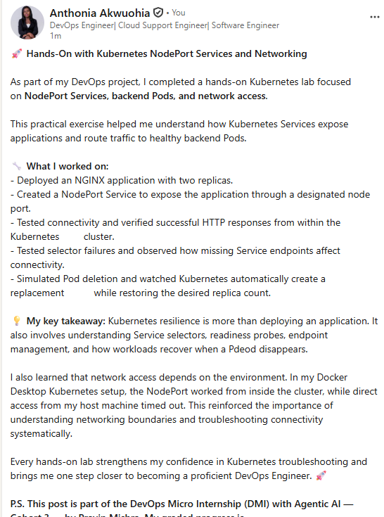

#### Linkedin post link

https://www.linkedin.com/posts/anthonia-akwuohia-5b00681b0_kubernetes-devops-cloudcomputing-share-7519381118953979904-wS90/?utm_source=share&utm_medium=member_desktop&rcm=ACoAADEhX1QBTHiW-kQPmKjn3MVixQzj4IzJO1Q

---

# Submission Instructions

- Include the completed YAML manifests created during the lab.
- Add all required screenshots: Screenshots 1–8 and 12–14.
- Include Screenshots 9–11 only if you attempted optional Task 5.
- Complete the Notes for Tasks 1–4 and Task 6.
- Complete Task 5 Notes only if you attempted that task.
- Use clear, readable screenshots showing the relevant commands and outputs.
- Ensure your full name is visible in the required screenshots.
- If NodePort access is restricted by your environment, include the failed request output, ready endpoint evidence, and an explanation.
- Do not expose passwords, access tokens, private keys, kubeconfig contents, or account IDs.

---

# Completion Checklist

- [ ] Created and entered `~/k8s-labs/services/nodeport` (Screenshot 1)
- [ ] Created and applied the NGINX Deployment manifest (Screenshot 2)
- [ ] Confirmed successful rollout and two ready NGINX Pods (Screenshot 3)
- [ ] Created the NodePort Service manifest (Screenshot 4)
- [ ] Verified the Service and its endpoints or EndpointSlices (Screenshot 5)
- [ ] Recorded the assigned or selected NodePort
- [ ] Identified a node IP (Screenshot 6)
- [ ] Confirmed that the `tester` Pod is running (Screenshot 7)
- [ ] Tested NodePort access, or documented the environment limitation with evidence (Screenshot 8)
- [ ] Optional: Tested and restored the Service selector (Screenshots 9–11)
- [ ] Deleted one NGINX Pod (Screenshot 12)
- [ ] Confirmed the replacement Pod and two running, ready Pods (Screenshot 13)
- [ ] Completed all required Notes
- [ ] Published the LinkedIn post (Screenshot 14)
- [ ] No sensitive data exposed

---

## 📌 About DMI & CloudAdvisory

DevOps Micro Internship (DMI) is a project-based DevOps program run by Pravin Mishra (The CloudAdvisory) focused on real-world execution, systems thinking, and career readiness.

It helps learners build strong DevOps foundations with hands-on experience.

---

## 📌 Resources

- 🌐 DMI Official Website: https://dmi.pravinmishra.com?utm_source=github&utm_medium=readme  
- 🎓 University: https://university.pravinmishra.com?utm_source=github&utm_medium=readme  
- 💬 Discord Community: https://discord.pravinmishra.com?utm_source=github&utm_medium=readme  
- 📝 Blog: https://dmi.pravinmishra.com/blog?utm_source=github&utm_medium=readme  
- ▶️ YouTube Playlist: https://www.youtube.com/playlist?list=PLFeSNDtI4Cho  
- 🔗 Pravin Mishra (LinkedIn): https://www.linkedin.com/in/pravin-mishra-aws-trainer/  
- 🏢 CloudAdvisory (LinkedIn): https://www.linkedin.com/company/thecloudadvisory/

---

*This submission is part of DevOps Micro Internship (DMI) — Agentic AI Track.*
