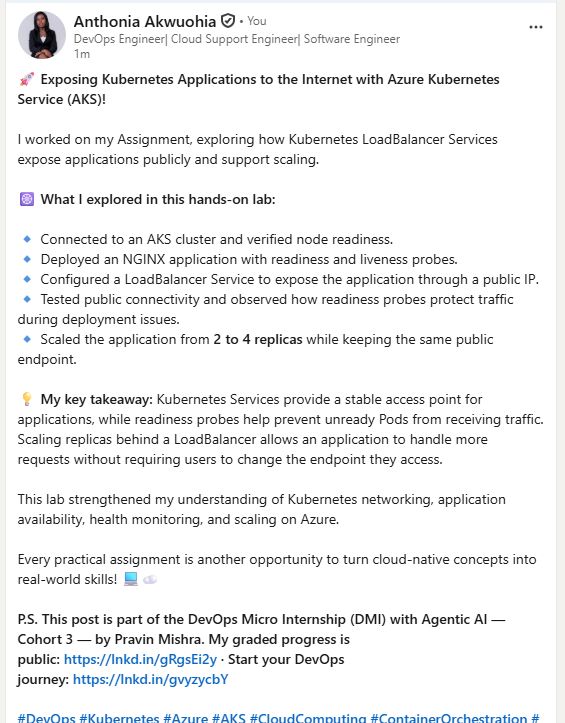

# Assignment 09 — Kubernetes Services: LoadBalancer on AKS

Part of the DevOps Micro Internship (DMI) with Agentic AI

---

## Purpose

Deploy a healthy NGINX application to Azure Kubernetes Service (AKS), expose it publicly using a LoadBalancer Service, observe readiness behavior, and scale the application behind the same public endpoint.

---

# Task 1 — Create or Connect to an AKS Cluster

## Goal

Create a small AKS cluster for this lab, or connect to an existing approved AKS lab cluster.

### Evidence

#### Screenshot 1 — Output of `kubectl get nodes` showing ready AKS node(s)

### Notes

**1. Why does this lab use a cloud-capable Kubernetes environment such as AKS for the LoadBalancer Service?**

AKS supports cloud-integrated LoadBalancer Services by provisioning an Azure Load Balancer and assigning a public IP address, allowing applications running in Kubernetes to be accessed externally.

**2. What Azure resources can Kubernetes provision when a LoadBalancer Service is created?**

Kubernetes can provision an Azure Load Balancer, a public IP address, and associated load-balancing rules and backend pool configurations to route external traffic to the appropriate Kubernetes nodes and Pods.

**3. Why is it important to delete unused AKS resources after the lab?**

Deleting unused AKS resources helps prevent unnecessary Azure charges, reduces resource consumption, and keeps the Azure environment clean. It is important to verify that associated resources, such as public IP addresses, load balancers, and the AKS cluster, are removed when no longer needed.

---

# Task 2 — Set Up Your Lab Directory

## Goal

Create and enter a dedicated directory for the LoadBalancer Service manifests.

### Evidence

#### Screenshot 2 — Terminal showing the output of `pwd` confirming that you are working inside `~/k8s-labs/services/loadbalancer`

Add your screenshot here.

### Notes

**1. Why is it useful to keep Kubernetes manifests organized in dedicated directories?**

Organizing Kubernetes manifests in dedicated directories makes configuration files easier to find, manage, update, and reuse. It also improves project structure and simplifies troubleshooting and version control.

**2. What are the names of the main Deployment and LoadBalancer Service YAML files you will create in this assignment?**

Deployment: deployment.yaml
LoadBalancer Service: service.yaml

---

# Task 3 — Deploy a Healthy NGINX Application

## Goal

Create a healthy NGINX Deployment with readiness and liveness probes.

### Evidence

#### Screenshot 3 — Completed `00-nginx-deploy.yaml` manifest

Add your screenshot here.

---

#### Screenshot 4 — Output showing successful rollout and two ready NGINX Pods

Add your screenshot here.

### Notes

**1. Why must Pods be ready before they should receive public traffic?**

Pods must be ready before receiving public traffic to ensure the application is running correctly and can handle requests. This prevents users from experiencing failed requests or service interruptions.

**2. What is the role of the readiness probe in this Deployment?**

The readiness probe checks whether a Pod is ready to serve traffic. If the check fails, Kubernetes removes the Pod from the Service's available endpoints until it becomes ready again.

**3. What is the role of the liveness probe in this Deployment?**

The liveness probe checks whether the application is still functioning properly. If the check repeatedly fails, Kubernetes restarts the affected container to help recover the application.

---

# Task 4 — Create and Test the LoadBalancer Service

## Goal

Create a public LoadBalancer Service and verify that the NGINX application is reachable from the internet.

### Evidence

#### Screenshot 5 — Completed `01-nginx-svc-loadbalancer.yaml` manifest

Add your screenshot here.

---

#### Screenshot 6 — Output showing the Service with an assigned EXTERNAL-IP

Add your screenshot here.

---

#### Screenshot 7 — Successful curl output from the public IP

Add your screenshot here.

### Notes

**1. What does `type: LoadBalancer` instruct AKS to do?**

It instructs Kubernetes to provision an Azure Load Balancer and expose the Service externally, allowing users to access the application through a public IP address.

**2. What public IP was assigned to your Service?**

The public IP assigned to my Service can be obtained by running:

kubectl get service

Replace this answer with the actual IP shown in the EXTERNAL-IP column.

**3. How does the public request eventually reach the NGINX Pods?**

The request reaches the Azure Load Balancer through the public IP address. The Load Balancer forwards traffic to the Kubernetes nodes, and the Kubernetes Service routes it to healthy, ready NGINX Pods.

**4. Why should you wait for EXTERNAL-IP before testing the Service?**

The EXTERNAL-IP may initially show pending while Azure provisions the required networking resources. Waiting until the public IP is assigned ensures the Service is ready for external access and can be tested correctly.

---

# Task 5 — Observe How Readiness Protects Public Traffic

## Goal

Intentionally break readiness and observe how Kubernetes excludes unready Pods from ready Service backends while existing healthy Pods continue serving public traffic.

### Evidence

#### Screenshot 8 — Completed `02-readiness-broken.yaml` patch file

Add your screenshot here.

---

#### Screenshot 9 — Output showing the expected incomplete rollout or readiness failure

Add your screenshot here.

---

#### Screenshot 10 — EndpointSlice output showing ready healthy backends and the effect of the readiness failure

Add your screenshot here.

---

#### Screenshot 11 — Successful public curl response after recovery

Add your screenshot here.

### Notes

**1. Why did the rollout not complete?**

The rollout did not complete because the new Pods failed their readiness probes and could not become ready to serve traffic. Kubernetes therefore waited for the new Pods to become healthy before completing the rollout.

**2. Why can the public endpoint still work while new Pods fail readiness?**

The public endpoint can still work because the existing healthy Pods continue to receive traffic through the LoadBalancer Service while the new Pods are not ready.

**3. What would happen if Kubernetes routed traffic to Pods before they were ready?**

Users could experience failed requests, errors, timeouts, or inconsistent application behavior because the Pods might not be ready to handle incoming traffic.

**4. How did you restore the Deployment successfully?**

I restored the Deployment by correcting the readiness probe configuration or rolling back to the previous stable revision. I then monitored the rollout with kubectl rollout status deployment/nginx and verified that the Pods became ready and the public endpoint worked successfully.

---

# Task 6 — Scale the Deployment Behind the Load Balancer

## Goal

Scale the NGINX Deployment and confirm that more ready Pods become available behind the same public endpoint.

### Evidence

#### Screenshot 12 — Two ready NGINX Pods verified initially; four ready Pods verified after scaling

Add your screenshot here.

---

#### Screenshot 13 — Successful public curl response after scaling

Add your screenshot here.

### Notes

**1. What changed after scaling the Deployment from two to four replicas?**

The number of NGINX Pod replicas increased from two to four, allowing the application to handle more requests and distribute traffic across additional Pods.

**2. Did the public IP change after scaling? Explain why or why not.**

No, the public IP remained the same because scaling changed the number of Pod replicas, not the LoadBalancer Service. The Service continued using the same public IP address.

**3. Why does scaling behind a LoadBalancer Service not require users to change the URL or IP they use?**

The LoadBalancer Service provides a stable public endpoint and automatically routes incoming traffic to available, ready Pods. Therefore, users can continue accessing the application through the same URL or IP address even when the number of replicas changes.

---

# Task 7 — Share Your LoadBalancer Lab on LinkedIn

## Goal

Share what you learned about exposing an NGINX application publicly through a LoadBalancer Service on AKS.

### Evidence

#### Screenshot 14 — Published LinkedIn post about your LoadBalancer lab on AKS

#### LinkedIn post link

https://www.linkedin.com/posts/anthonia-akwuohia-5b00681b0_devops-kubernetes-azure-share-7519713169942958080-DZX_/?utm_source=share&utm_medium=member_desktop&rcm=ACoAADEhX1QBTHiW-kQPmKjn3MVixQzj4IzJO1Q

---

# Submission Instructions

- Include the completed YAML files:
  - `00-nginx-deploy.yaml`
  - `01-nginx-svc-loadbalancer.yaml`
  - `02-readiness-broken.yaml`
- Add all required screenshots, numbered 1–14, under their corresponding Evidence sections.
- Use clear, readable screenshots showing the relevant commands, configuration, and outputs.
- Ensure your full name is visible in the required screenshots.
- Complete the Notes for Tasks 1–6 in your own words.
- Capture all required evidence before cleaning up Azure resources.
- Plan or complete Azure cleanup according to your lab ownership and reuse arrangements.
- Do not expose passwords, tokens, private keys, cluster credentials, kubeconfig contents, subscription IDs, account IDs, or infrastructure details you are not permitted to share.

---

# Completion Checklist

- [ ] Created or connected to an approved AKS lab cluster
- [ ] Confirmed ready AKS node(s) (Screenshot 1)
- [ ] Created and entered the LoadBalancer lab directory (Screenshot 2)
- [ ] Created the NGINX Deployment manifest (Screenshot 3)
- [ ] Verified successful rollout and two ready NGINX Pods initially (Screenshot 4)
- [ ] Created the LoadBalancer Service manifest (Screenshot 5)
- [ ] Verified the assigned external IP (Screenshot 6)
- [ ] Verified successful public access using curl (Screenshot 7)
- [ ] Created the broken readiness patch (Screenshot 8)
- [ ] Observed the expected incomplete rollout or readiness failure (Screenshot 9)
- [ ] Inspected EndpointSlices during the readiness failure (Screenshot 10)
- [ ] Restored the healthy Deployment and verified public access (Screenshot 11)
- [ ] Scaled the Deployment to four ready Pods and verified updated Service backends (Screenshot 12)
- [ ] Verified public access after scaling (Screenshot 13)
- [ ] Completed the Notes for Tasks 1–6
- [ ] Published the LinkedIn post (Screenshot 14)
- [ ] Included all required YAML files and screenshots
- [ ] Planned or completed Azure cleanup
- [ ] No sensitive data exposed

---

## 📌 About DMI & CloudAdvisory

DevOps Micro Internship (DMI) is a project-based DevOps program run by Pravin Mishra (The CloudAdvisory) focused on real-world execution, systems thinking, and career readiness.

It helps learners build strong DevOps foundations with hands-on experience.

---

## 📌 Resources

- 🌐 DMI Official Website: https://dmi.pravinmishra.com?utm_source=github&utm_medium=readme  
- 🎓 University: https://university.pravinmishra.com?utm_source=github&utm_medium=readme  
- 💬 Discord Community: https://discord.pravinmishra.com?utm_source=github&utm_medium=readme  
- 📝 Blog: https://dmi.pravinmishra.com/blog?utm_source=github&utm_medium=readme  
- ▶️ YouTube Playlist: https://www.youtube.com/playlist?list=PLFeSNDtI4Cho  
- 🔗 Pravin Mishra (LinkedIn): https://www.linkedin.com/in/pravin-mishra-aws-trainer/  
- 🏢 CloudAdvisory (LinkedIn): https://www.linkedin.com/company/thecloudadvisory/

---

*This submission is part of DevOps Micro Internship (DMI) — Agentic AI Track.*
