# Assignment 10 — Capstone: Deploy the Book Review App to Kubernetes

Part of the DevOps Micro Internship (DMI) with Agentic AI

---

## Purpose

Deploy the Book Review App as a production-style three-tier application using Kubernetes manifests or Helm charts, with an accessible frontend, an internal backend, and a managed or persistent MySQL database.

---

## Submission Details

**Full Name:** Anthonia Akwuohia

**Kubernetes Platform:** Add your platform here.

**Namespace:** book-review

**Frontend URL or IP:** Add the working endpoint here.

**Access Method:** Public LoadBalancer, Ingress, or documented local access.

**GitHub Manifests or Helm Chart URL:** Add your repository link here.

**Architecture Diagram:** Add your diagram or link here.

---

# Task 1 — Prepare the Kubernetes Cluster and Project

## Goal

Prepare the cluster, application source, container images, and tooling needed for the deployment.

### Evidence

#### Screenshot 1 — Active Kubernetes context and Ready nodes

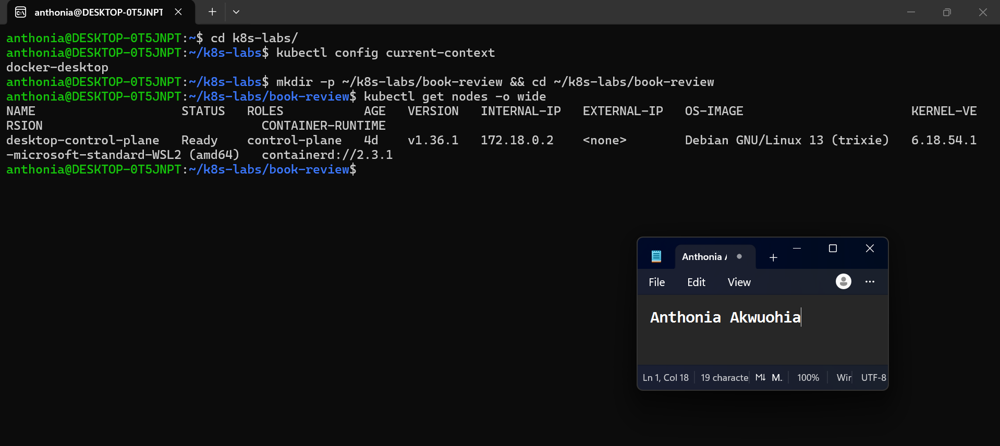

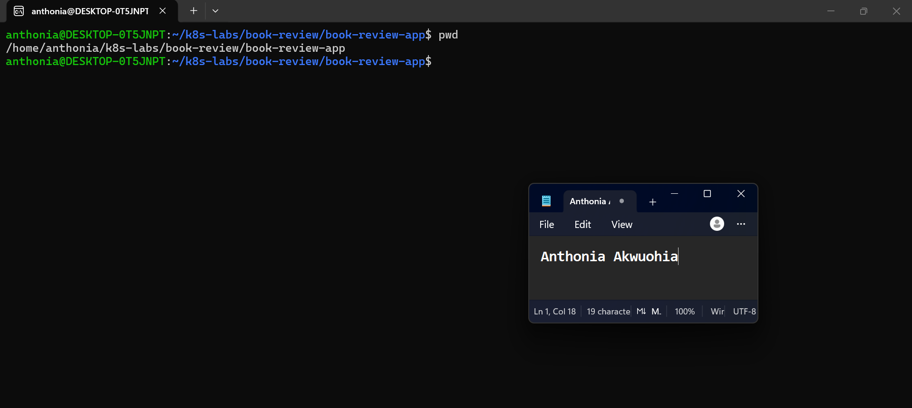

---

#### Screenshot 2 — If using Helm: Output of `helm version`

Required only if you choose Helm. Skip this screenshot if using YAML manifests.

Add your screenshot here, or write “Not applicable — using YAML manifests.”

---

# Task 2 — Design the Three-Tier Kubernetes Architecture

## Goal

Document the workloads, networking, configuration, storage, and permitted communication paths before deployment.

### Evidence

#### Screenshot 3 — Completed Kubernetes architecture diagram

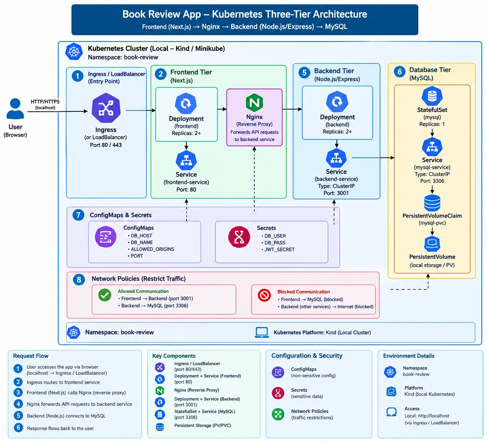

---

# Task 3 — Create ConfigMaps and Secrets

## Goal

Provide application configuration and credentials without embedding sensitive values in images or committing them to Git.

### Evidence

#### Screenshot 4 — ConfigMap configuration or describe output showing non-sensitive values

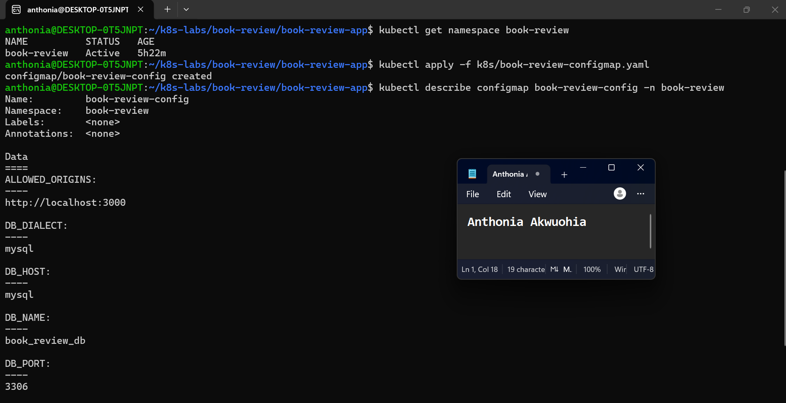

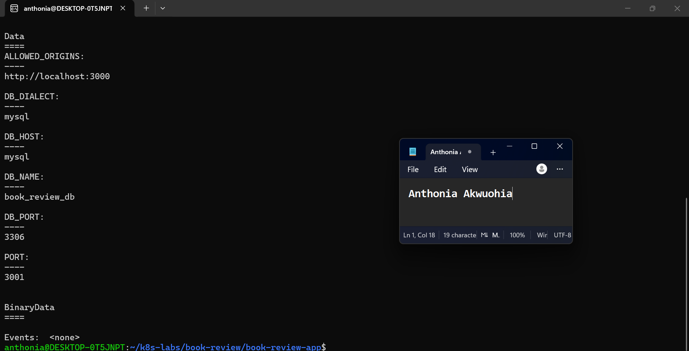

---

#### Screenshot 5 — Secret references or describe output showing names and keys without sensitive values

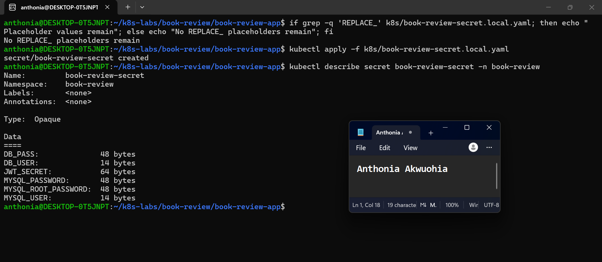

---

# Task 4 — Deploy and Configure the MySQL Data Tier

## Goal

Provide persistent MySQL storage and allow the backend to connect without exposing the database publicly.

### Evidence

#### Screenshot 6 — Managed MySQL status or MySQL StatefulSet and PVC status

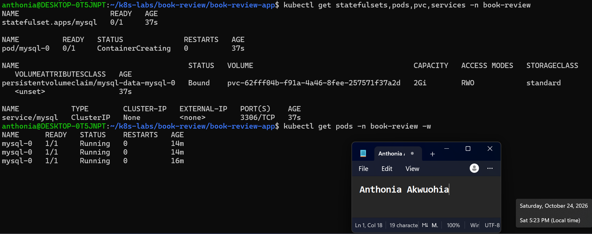

---

#### Screenshot 7 — Successful database connectivity or schema verification with credentials hidden

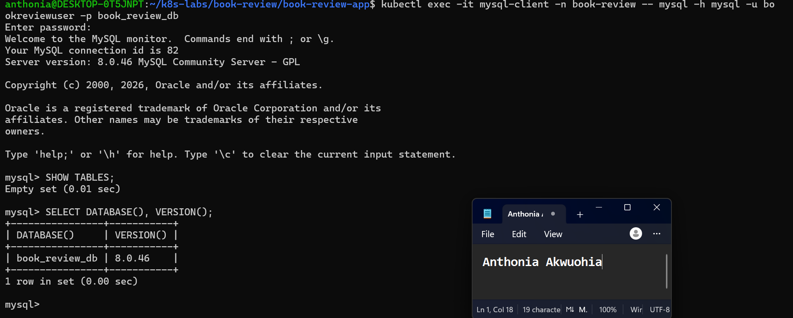

---

# Task 5 — Deploy the Backend Application Tier

## Goal

Run one or two Node.js/Express backend replicas on port 3001 and expose them through an internal ClusterIP Service.

### Evidence

#### Screenshot 8 — Backend Deployment, ready Pods, and internal Service

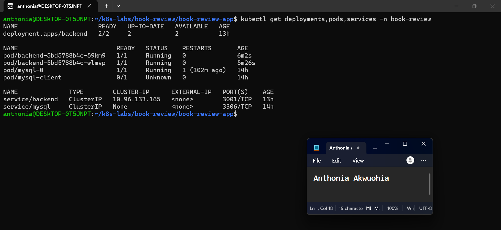

---

#### Screenshot 9 — Backend startup logs and database connectivity evidence

If the application does not log successful database connections, provide a successful database-backed request alongside the startup logs.

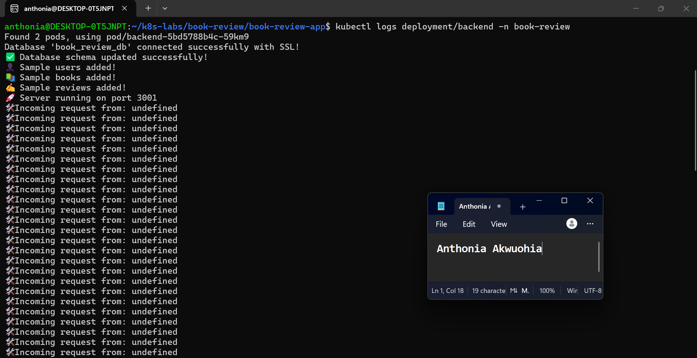

---

# Task 6 — Deploy the Frontend and Configure Nginx

## Goal

Run the Next.js frontend behind Nginx on port 80 and proxy API requests to the internal backend Service.

### Evidence

#### Screenshot 10 — Frontend Deployment and Ready Pods

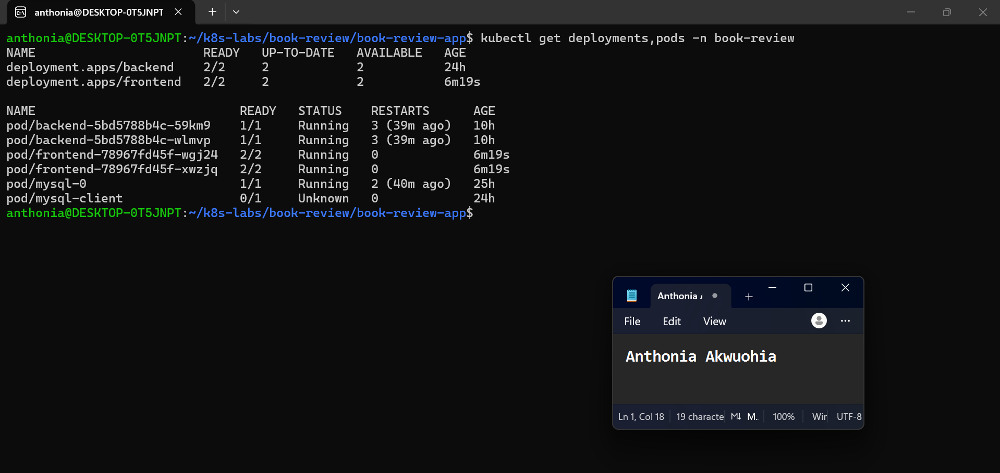

---

#### Screenshot 11 — Nginx reverse-proxy configuration showing the internal backend Service name and port 3001

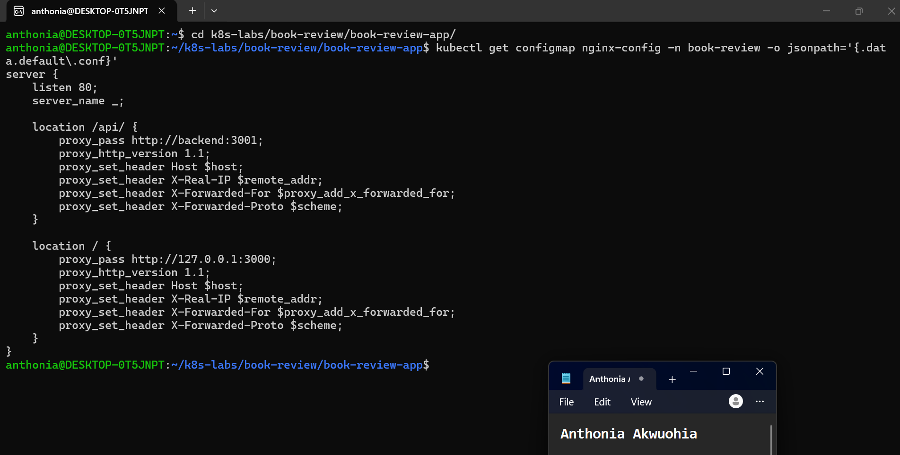

---

# Task 7 — Configure External and Internal Networking

## Goal

Expose the frontend and enforce the intended communication path between application tiers.

### Evidence

#### Screenshot 12 — Frontend LoadBalancer or Ingress configuration and assigned endpoint, or documented local access method

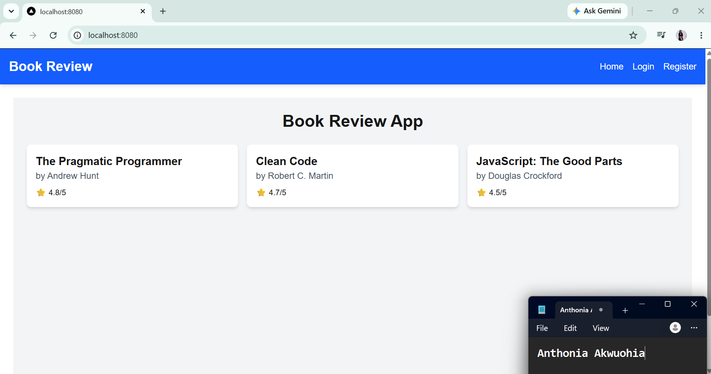

---

#### Screenshot 13 — Internal backend Service and NetworkPolicy or equivalent restriction, with access-test evidence

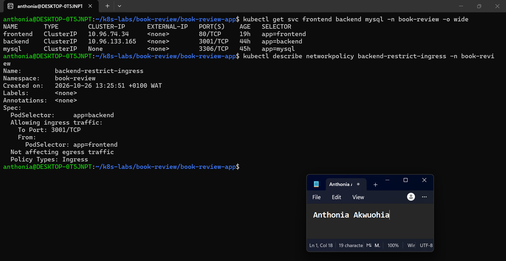

---

# Task 8 — Validate the Application End to End

## Goal

Prove that the frontend, backend, and MySQL database work together and collect operational evidence.

### Evidence

#### Screenshot 14 — `kubectl get all` output for the book-review namespace

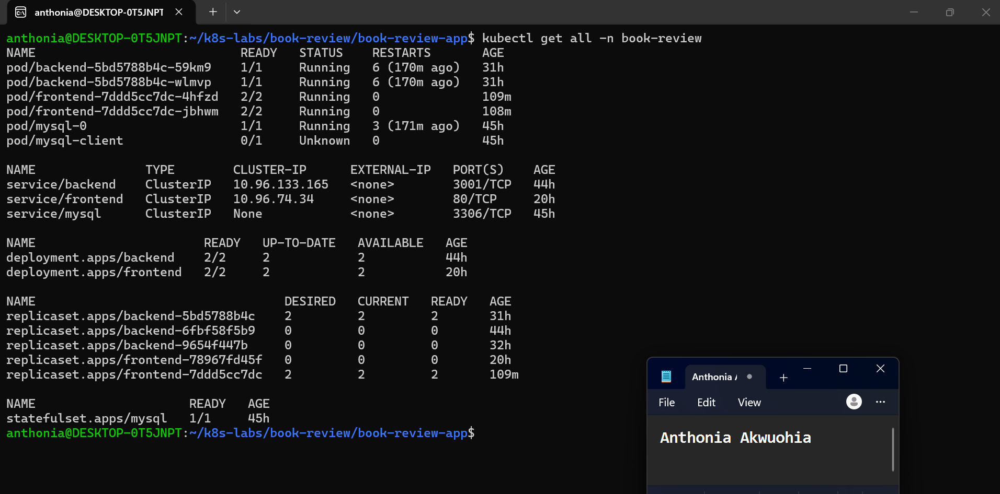

---

#### Screenshot 15 — Functional Book Review App in the browser with the URL visible, including evidence of a successful user flow

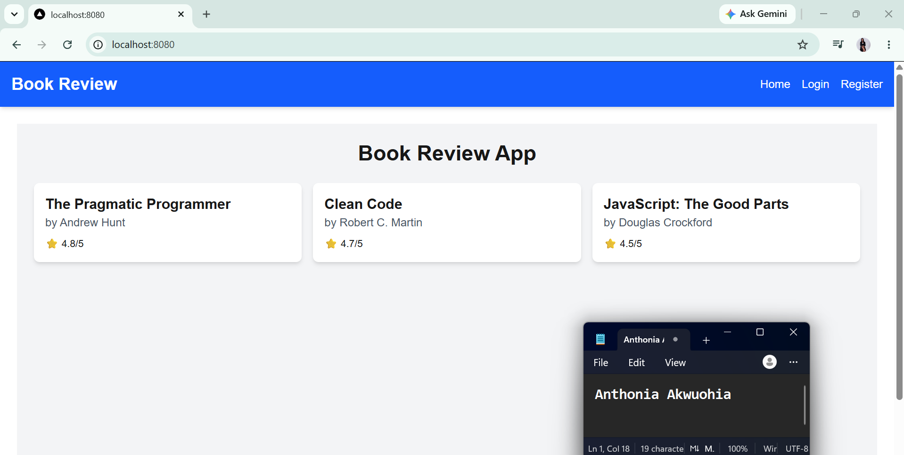

---

#### Screenshot 16 — Frontend or Nginx container logs

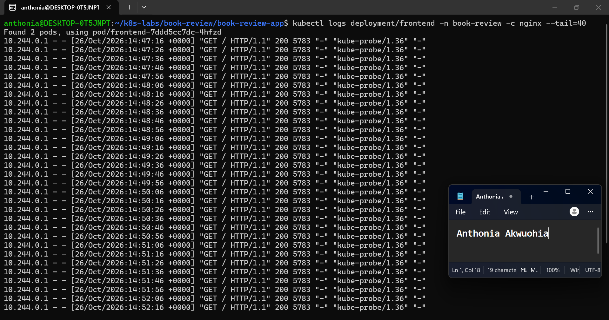

---

#### Screenshot 17 — Backend logs and evidence of a successful database-backed operation

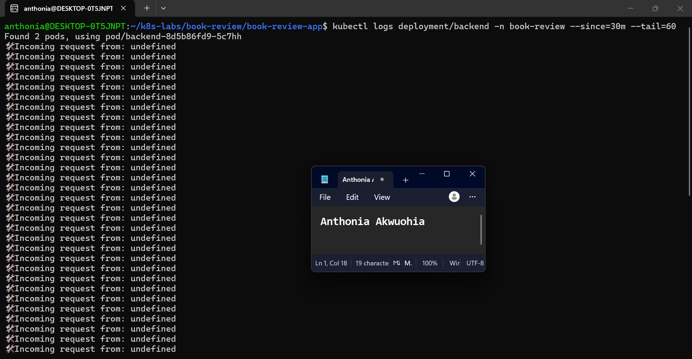

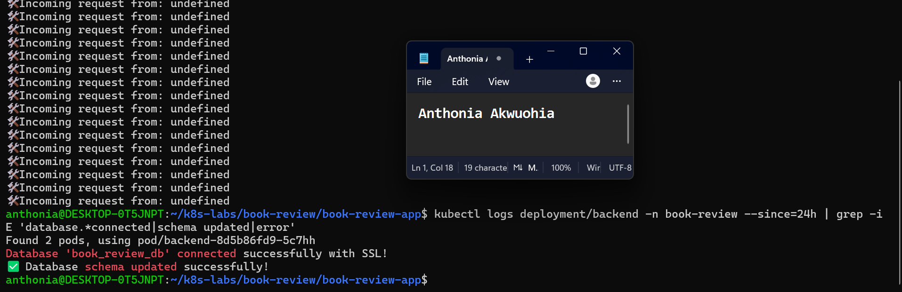

---

#### Screenshot 18 — Optional: Kubernetes dashboard

Note: Kubernetes Dashboard was not installed in the Docker Desktop cluster, so no Dashboard screenshot was captured. Application health and deployment status were verified using kubectl commands and the running application in the browser instead.

Multiple images may be included under a screenshot number when needed to demonstrate the complete user flow.

---

# Task 9 — Optional: Implement Production Improvements

## Goal

Add selected improvements without breaking the required three-tier architecture.

### Evidence

#### Screenshot 19 — Optional: Evidence of selected Helm, HPA, probe, or TLS improvements

**Screenshot 19 — Optional Production Improvements**

The Book Review application was enhanced and validated on Docker Desktop Kubernetes.

- **Readiness probes:** Configured for the Next.js frontend, Nginx, and backend to help Kubernetes determine when containers are ready to serve traffic.
- **Resource management:** CPU and memory requests and limits were configured for frontend and backend containers.
- **Network security:** A NetworkPolicy restricts backend ingress to frontend Pods on TCP port 3001.
- **Availability and recovery:** Both frontend and backend Deployments have two available replicas. Backend recovery was verified after a controlled restart.
- **Three-tier architecture:** Frontend, backend, and MySQL remain separate workloads communicating through Kubernetes Services.

**Validation result:** Both frontend and backend Deployments reported 2/2 available replicas. The application successfully loaded books, supported user authentication and review submission, and retained submitted reviews after a refresh and backend restart.

**Not implemented:** Helm packaging, HPA, TLS/Ingress, and liveness probes were not included in this optional improvement stage.

---

# Task 10 — Publish Your Book Review App Deployment on LinkedIn

## Goal

Explain your three-tier architecture, demonstrate the working application, and share what you learned.

### Evidence

#### Screenshot 20 — Published LinkedIn post about your Book Review App deployment on Kubernetes

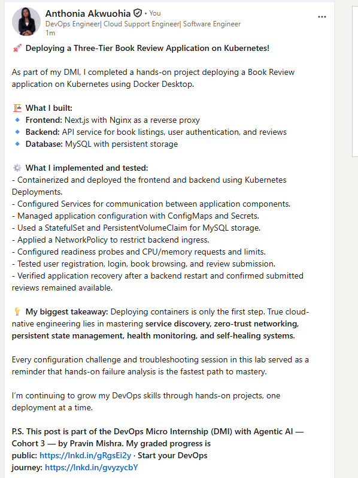

### LinkedIn Post URL

https://www.linkedin.com/posts/anthonia-akwuohia-5b00681b0_kubernetes-devops-docker-share-7520508114056441856-NCRA/?utm_source=share&utm_medium=member_desktop&rcm=ACoAADEhX1QBTHiW-kQPmKjn3MVixQzj4IzJO1Q

---

# Final Summary

## What Worked

Describe the application components and user flows you successfully deployed and tested.

Successfully deployed and tested a three-tier Book Review application on Docker Desktop Kubernetes in the book-review namespace.

Frontend: Deployed the Next.js application with Nginx as a reverse proxy, running two frontend replicas.

Backend: Deployed two backend replicas to handle API requests and application logic.

Database: Deployed MySQL using a StatefulSet and persistent volume claim, with configuration and credentials managed through a ConfigMap and Kubernetes Secret.

Services and networking: Created Kubernetes Services for frontend, backend, and MySQL communication.

User flows: Verified book listings, user registration, login, book details, and review submission.

Persistence: Confirmed that submitted reviews remained visible after refreshing the page and restarting the backend.

Validation: Verified successful API responses, database connectivity, and healthy frontend and backend Deployments with 2/2 available replicas.

The application was accessed locally through port-forwarding at http://localhost:8080.

## Issues and Fixes

Describe the main issues encountered, their causes, and how you resolved them.

Frontend API routing: Incorrect API path construction caused a routing issue. Updated the frontend API request to use /api/books correctly.

CORS registration failure: Registration initially failed because the backend did not allow the frontend's http://localhost:8080 origin. Updated ALLOWED_ORIGINS in the ConfigMap to include both http://localhost:3000 and http://localhost:8080, then restarted the backend Deployment. Registration and login subsequently worked.

NetworkPolicy testing: A temporary test Pod could not access the backend because it did not have the required app=frontend label. Verified that the actual frontend Pods could access the backend while unrelated Pods were restricted.

Local networking: Used Kubernetes port-forwarding to access the frontend from the host browser without exposing the application publicly.

## Tools and Sources Used

List the documentation and tools that helped you complete the assignment.

Docker Desktop and Docker Desktop Kubernetes

Ubuntu on WSL

Kubernetes CLI (kubectl)

Docker for building and publishing container images

Docker Hub for storing frontend and backend images

YAML for Kubernetes Deployments, Services, ConfigMaps, Secrets, StatefulSet, and NetworkPolicy

Browser-based application testing

Kubernetes resource descriptions and container logs for troubleshooting

Official Kubernetes documentation: https://kubernetes.io/docs/

Official Docker documentation: https://docs.docker.com/

Official NGINX documentation: https://nginx.org/en/docs/

## Optional Improvements

Describe any optional improvements implemented, or write “Not attempted.”

Implemented and validated selected production improvements:

Readiness probes for the Next.js frontend, Nginx, and backend.

CPU and memory requests and limits for application containers.

NetworkPolicy restricting backend ingress to frontend Pods on TCP port 3001.

Two replicas each for the frontend and backend, with successful recovery after a controlled backend restart.

Persistent storage for MySQL through a persistent volume claim.

Helm chart packaging, Horizontal Pod Autoscaling (HPA), TLS through Ingress and cert-manager, and liveness probes were not implemented.

## Cleanup or Reuse Plan

State which resources were removed or why the environment is being retained.

Cleanup or Reuse Plan

The Docker Desktop Kubernetes environment is being retained for future learning, testing, and reuse. The book-review namespace and its application resources, including the MySQL StatefulSet and persistent storage, have not been intentionally removed.

The frontend is accessed through local port-forwarding, and the application is not publicly exposed. Before future testing, I will verify the status of the Pods, Services, Deployments, and persistent storage. I will remove the lab resources and persistent data when they are no longer needed, after confirming that no required data must be retained.

---

# Submission Instructions

- Include your Kubernetes manifests or Helm chart in the linked repository.
- Submit Secret examples containing placeholders only.
- Include Screenshot 1, Screenshots 3–17, and Screenshot 20.
- Include Screenshot 2 only if using Helm.
- Screenshots 18–19 are optional.
- Keep screenshot numbering consistent with the guidelines.
- Use clear, readable screenshots showing relevant configuration, commands, and outputs.
- Make your full name visible in required screenshots.
- Complete the submission details and Final Summary.
- Include your published LinkedIn post URL.
- Capture required evidence before cleanup.
- Do not expose passwords, tokens, JWT secrets, actual Secret values, kubeconfig contents, cloud credentials, or confidential account information.

---

# Completion Checklist

- [ ] Selected and configured a supported Kubernetes platform
- [ ] Confirmed the context and Ready nodes (Screenshot 1)
- [ ] Created and selected the book-review namespace
- [ ] Inspected the application repository
- [ ] Prepared images accessible to the cluster
- [ ] Confirmed Helm if using charts (Screenshot 2, conditional)
- [ ] Created the architecture diagram (Screenshot 3)
- [ ] Created ConfigMaps and Secrets (Screenshots 4–5)
- [ ] Excluded actual Secret values from Git and screenshots
- [ ] Provisioned private managed MySQL or persistent Kubernetes MySQL (Screenshot 6)
- [ ] Initialized the required database and schema
- [ ] Verified database connectivity or schema (Screenshot 7)
- [ ] Deployed one or two backend replicas listening on port 3001
- [ ] Created the backend ClusterIP Service (Screenshot 8)
- [ ] Verified backend-to-database connectivity (Screenshot 9)
- [ ] Deployed one or two frontend replicas behind Nginx (Screenshot 10)
- [ ] Configured API proxying through the internal backend Service (Screenshot 11)
- [ ] Configured and documented frontend access (Screenshot 12)
- [ ] Enforced backend access restrictions (Screenshot 13)
- [ ] Confirmed that the backend and database are not publicly exposed
- [ ] Captured resource status for book-review (Screenshot 14)
- [ ] Tested application functionality and database writes (Screenshots 15 and 17)
- [ ] Verified saved data after application restart
- [ ] Captured frontend and backend logs (Screenshots 16–17)
- [ ] Included optional dashboard or improvement evidence if attempted (Screenshots 18–19)
- [ ] Published the LinkedIn post (Screenshot 20)
- [ ] Included the LinkedIn post URL
- [ ] Documented issues, fixes, and useful sources
- [ ] Recorded cleanup status or reuse plans
- [ ] No sensitive data exposed

---

## 📌 About DMI & CloudAdvisory

DevOps Micro Internship (DMI) is a project-based DevOps program run by Pravin Mishra (The CloudAdvisory) focused on real-world execution, systems thinking, and career readiness.

It helps learners build strong DevOps foundations with hands-on experience.

---

## 📌 Resources

- 🌐 DMI Official Website: https://dmi.pravinmishra.com?utm_source=github&utm_medium=readme  
- 🎓 University: https://university.pravinmishra.com?utm_source=github&utm_medium=readme  
- 💬 Discord Community: https://discord.pravinmishra.com?utm_source=github&utm_medium=readme  
- 📝 Blog: https://dmi.pravinmishra.com/blog?utm_source=github&utm_medium=readme  
- ▶️ YouTube Playlist: https://www.youtube.com/playlist?list=PLFeSNDtI4Cho  
- 🔗 Pravin Mishra (LinkedIn): https://www.linkedin.com/in/pravin-mishra-aws-trainer/  
- 🏢 CloudAdvisory (LinkedIn): https://www.linkedin.com/company/thecloudadvisory/

---

*This submission is part of DevOps Micro Internship (DMI) — Agentic AI Track.*
