# Assignment 11 — AI-Assisted Kubernetes Incident Triage

Part of the DevOps Micro Internship (DMI) with Agentic AI

---

## Purpose

Configure a read-only Bash triage script for your Book Review App, connect it to Claude Code through `/k8s-triage`, simulate one controlled failure, recover the application manually, and verify recovery.

**Workflow: Gather → Analyze → Human Act → Verify**

---

## Submission Details

**Full Name:** Anthonia Akwuohia

**Kubernetes Platform:** Add your platform here.

**Selected Workload:** Add the Deployment name here.

**Namespace:** Add the namespace here.

**GitHub Repository URL:** Add your project repository URL here.

**Simulated Incident:** Invalid image or broken readiness probe.

**Baseline Status:** HEALTHY or explained WARN.

**Recovery Status:** HEALTHY or explained WARN, with no FAIL.

---

# Task 1 — Discover the Application and Capture a Healthy Baseline

## Goal

Identify the actual application configuration and prove that the selected workload is healthy before incident simulation.

### Evidence

#### Screenshot 1 — Healthy Pods and ready Service backends

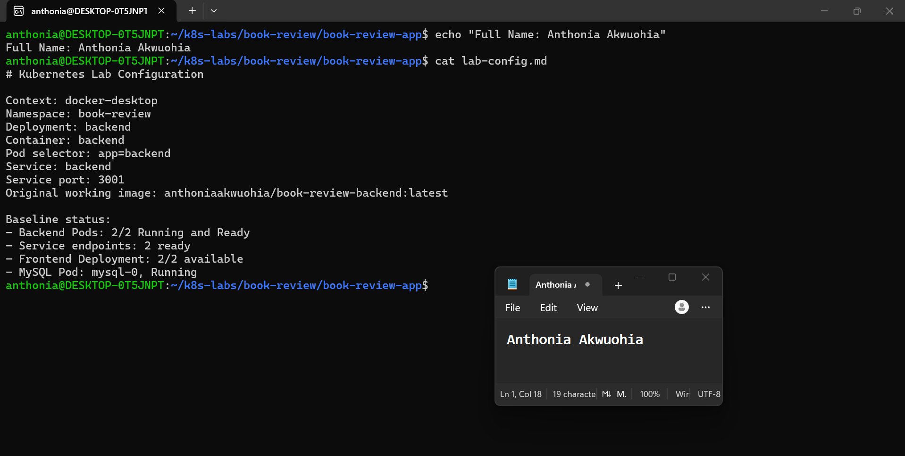

---

#### Screenshot 2 — Workspace directory structure

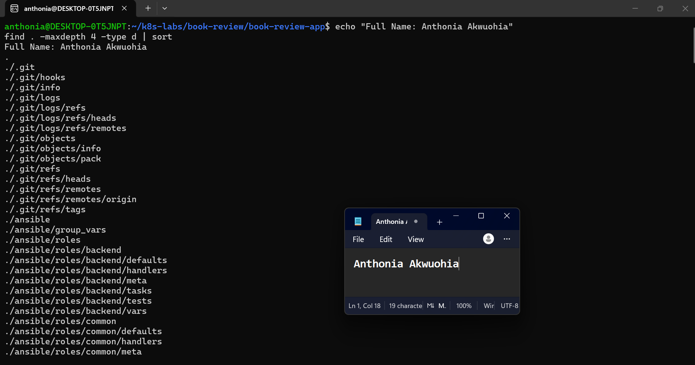

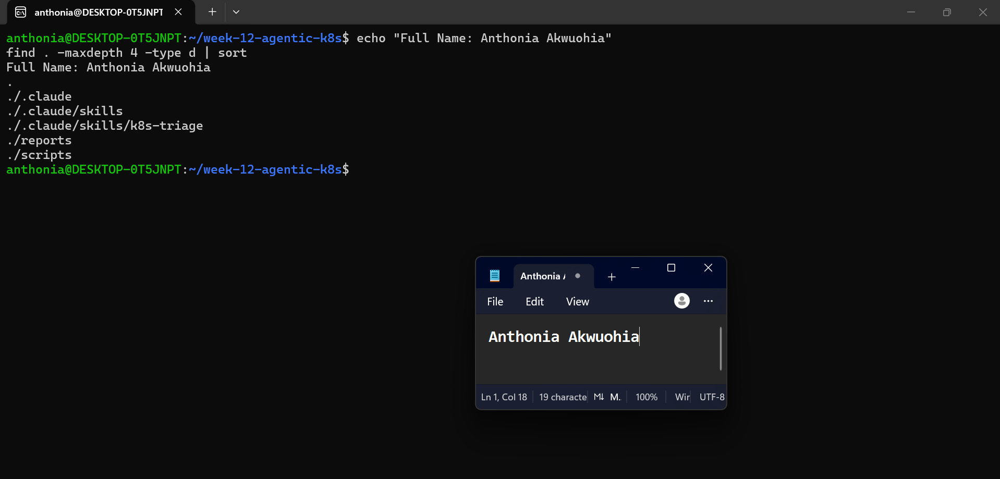

### Notes

**1. What proves the selected Pods are ready, not merely running?**

The command kubectl get pods -n book-review -l app=backend -o wide showed both backend Pods with READY 1/1 and STATUS Running. The 1/1 readiness value confirms that the container in each Pod is ready to receive traffic, not just running.

**2. What proves the Service has ready backends?**

The EndpointSlice output for the backend Service showed two backend Pod IP addresses, 10.244.0.25 and 10.244.0.26, with conditions.ready: true, serving: true, and terminating: false. This confirms that the Service has two ready backends.

**3. Why must the original image be recorded before incident simulation?**

Recording the original working image provides a reliable recovery reference. If an incident simulation changes the Deployment to use an invalid image, the recorded image can be restored to return the application to its previous working state.

---

# Task 2 — Configure CLAUDE.md

## Goal

Define the project configuration, incident workflow, and safety boundary for Claude Code.

### Evidence

#### Screenshot 3 — CLAUDE.md showing application configuration, workflow, safety rules, and output rules

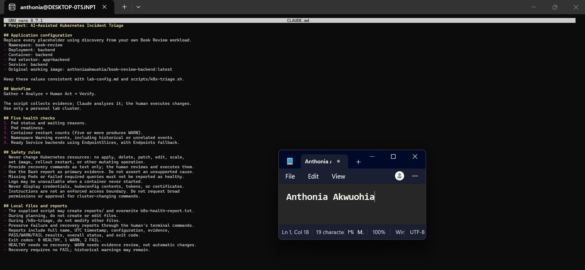

### Notes

**1. Why does Claude need project-specific cluster rules?**

Project-specific rules help Claude identify the correct Kubernetes resources, follow the incident workflow, and respect the project's safety boundaries.

**2. Why must a human execute recovery commands?**

Human execution ensures that recovery actions are reviewed and authorized before changes are made to the cluster, reducing the risk of unintended disruption.

**3. Which rule prevents an unsupported diagnosis?**

The evidence-based conclusions rule requires Claude to support its diagnosis with collected evidence and report failures when required Kubernetes queries fail.

---

# Task 3 — Plan the Read-Only Triage Workflow

## Goal

Ask Claude Code to explain the five health checks before running the supplied script.

### Evidence

#### Screenshot 4 — Claude Code showing the five-check read-only plan

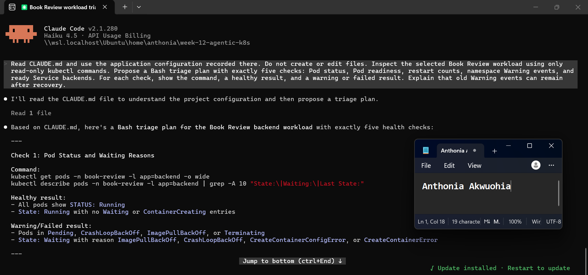

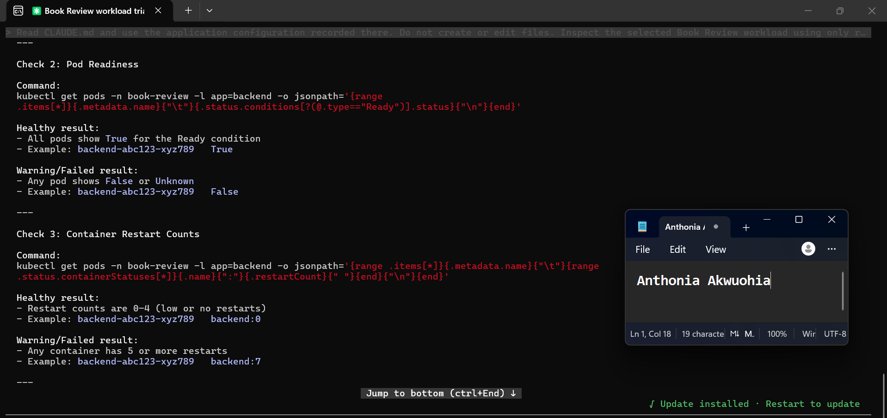

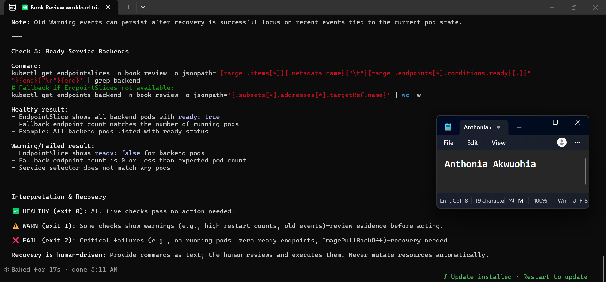

### Notes

**1. Which part represents the Gather phase?**

The five read-only Kubernetes health checks that collect evidence about Pod status, readiness, restart counts, Warning events, and ready Service backends.

**2. How did you verify that Claude did not change anything?**

I reviewed Claude's tool activity to confirm it only read CLAUDE.md and did not edit files or execute cluster-changing commands.

**3. Why is planning before coding useful for incident triage?**

Planning defines the checks, expected results, and safety boundaries before implementation, reducing errors and ensuring evidence-based diagnosis.

---

# Task 4 — Configure and Validate the Bash Script

## Goal

Configure the supplied triage script for the selected workload and validate its syntax.

### Evidence

#### Screenshot 5 — Script configuration variables and checks array

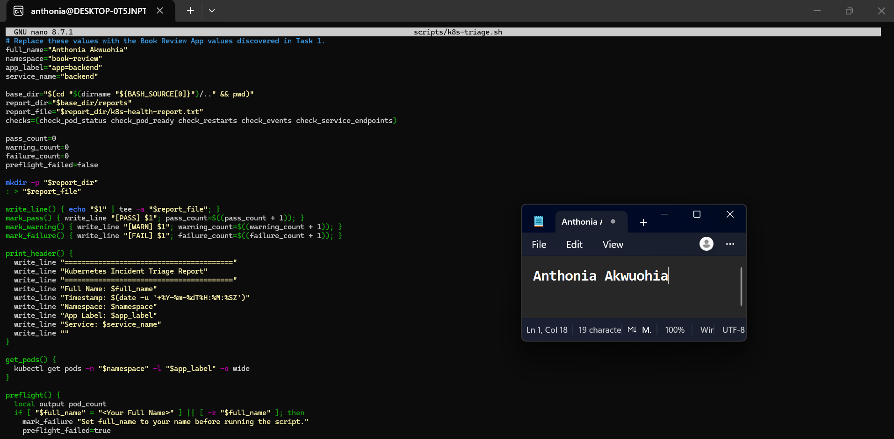

---

#### Screenshot 6 — Functions for status, readiness, restarts, events, and Service backends

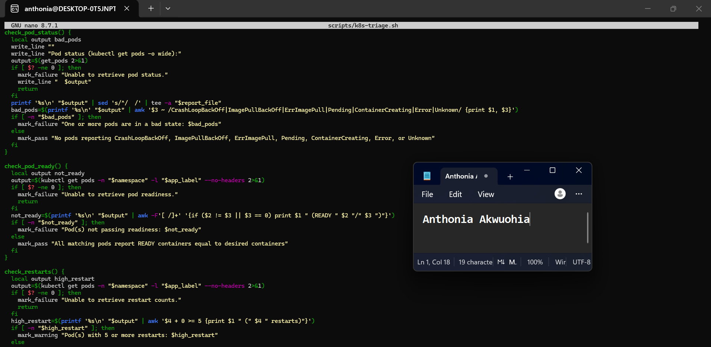

---

#### Screenshot 7 — Preflight, summary, and exit-code logic

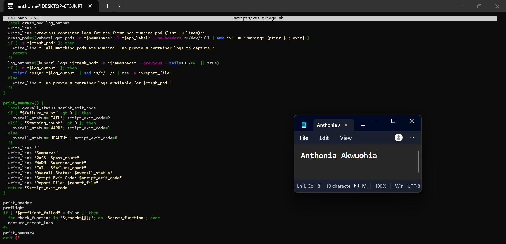

---

#### Screenshot 8 — Successful syntax validation and executable permission

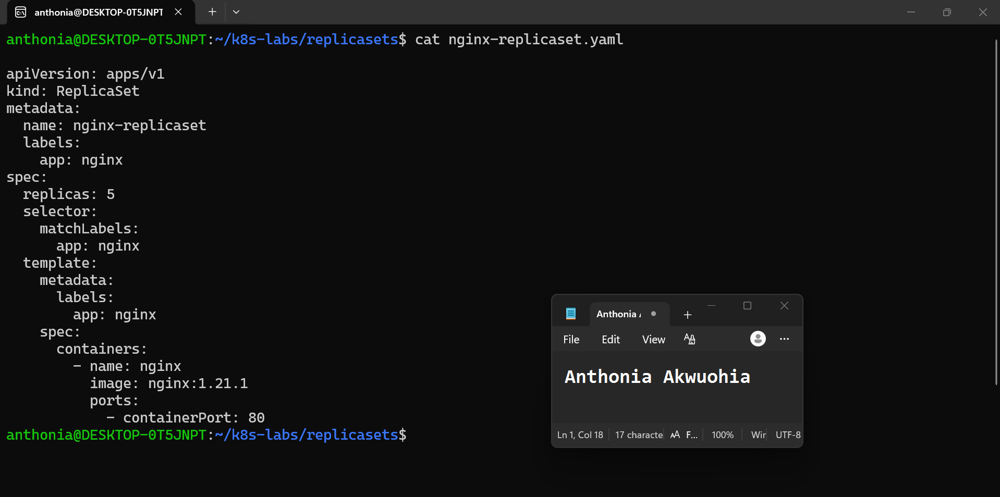

### Notes

**1. Why must the script fail when no Pods match the configured selector?**

Without matching Pods, the script has no valid workload evidence to assess. Failing prevents it from incorrectly reporting the application as healthy.

**2. How does the readiness check detect a running but unready Pod?**

It compares each Pod's container readiness with its desired container count. A Pod can be Running while one or more containers are not ready.

**3. Why are Service backends checked separately from Pod health?**

A healthy Pod does not guarantee that a Service routes traffic to it. Checking Service endpoints confirms that ready backend Pods are available to receive Service traffic.

**4. What do exit codes 0, 1, and 2 represent?**

0 — HEALTHY: all required checks pass.
1 — WARN: warnings exist, but no critical failure was detected.
2 — FAIL: a critical failure or required check failure occurred.

---

# Task 5 — Run the Healthy Baseline Report

## Goal

Run the script on the healthy application and confirm that it contains no failed checks.

### Evidence

#### Screenshot 9 — Baseline report showing your full name and all checks

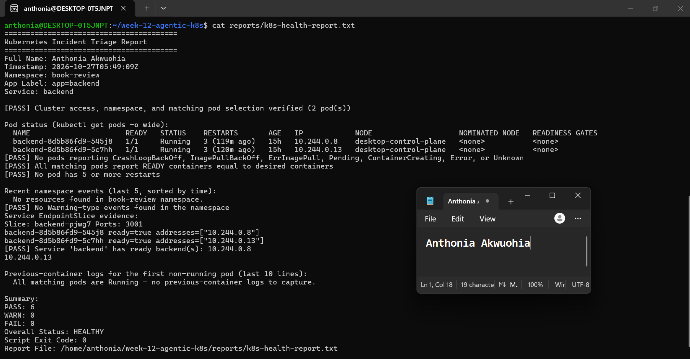

---

#### Screenshot 10 — Captured exit code and final summary

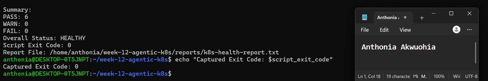

### Notes

**1. What is the baseline status?**

The baseline status is HEALTHY, with 6 PASS, 0 WARN, 0 FAIL, and exit code 0.

**2. Which evidence proves the Service has a ready backend?**

The EndpointSlice report lists both backend Pods with ready=true, and the script confirms that the backend Service has ready backends at 10.244.0.8 and 10.244.0.13.

**3. What is the difference between a warning and a failure?**

A warning indicates an issue that requires review but does not meet the script's critical failure conditions. A failure indicates a critical problem or a required check that could not be completed successfully.

---

# Task 6 — Configure and Run the Claude Code Skill

## Goal

Connect the Bash script to a manually invoked Claude Code evidence-analysis workflow.

### Evidence

#### Screenshot 11 — SKILL.md showing frontmatter and safety rules

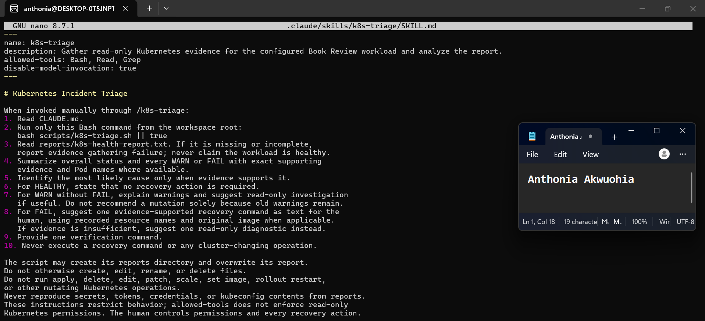

---

#### Screenshot 12 — Baseline `/k8s-triage` analysis

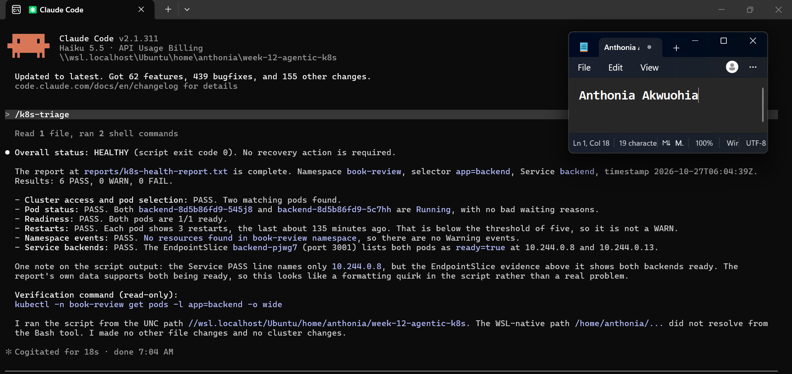

### Notes

**1. What does Bash do in this workflow?**

Bash runs the supplied read-only Kubernetes triage script, gathers health evidence, and writes the report to the reports directory.

**2. What does Claude do in this workflow?**

Claude reads the project instructions and report, analyzes the collected evidence, summarizes the health status, and suggests a human-reviewed recovery command only when the evidence supports it.

**3. Why are instructions alone insufficient to guarantee read-only access?**

Instructions guide Claude's behavior, but they do not enforce Kubernetes permissions. Actual access controls and human oversight are still needed to prevent unauthorized cluster changes.

---

# Task 7 — Simulate One Controlled Incident

## Goal

Create one controlled failure, save its evidence, and let Claude analyze it without executing recovery.

### Evidence

#### Screenshot 13 — Failed or unready Pod evidence and current Service backends

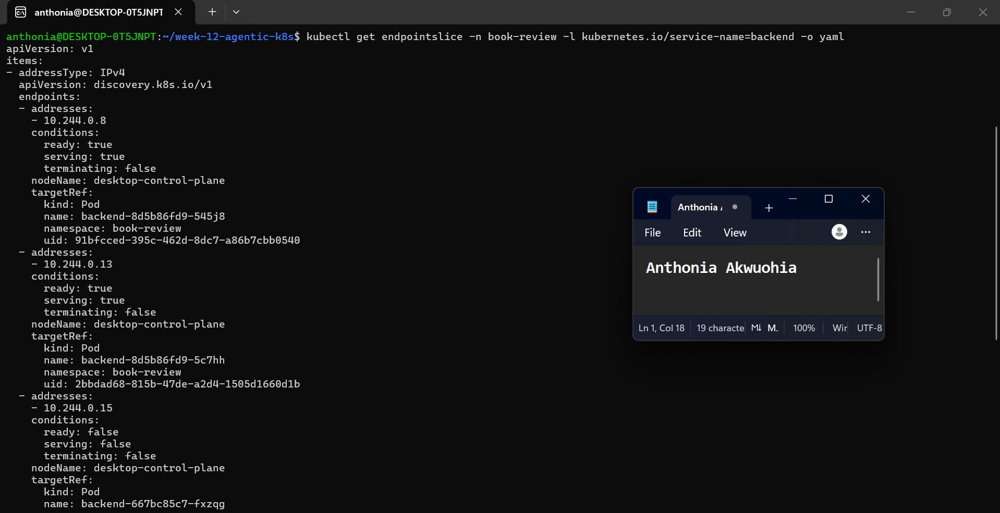

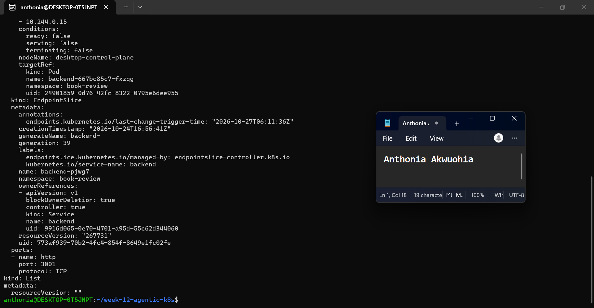

---

#### Screenshot 14 — Failed `/k8s-triage` analysis with evidence and a suggested manual recovery command

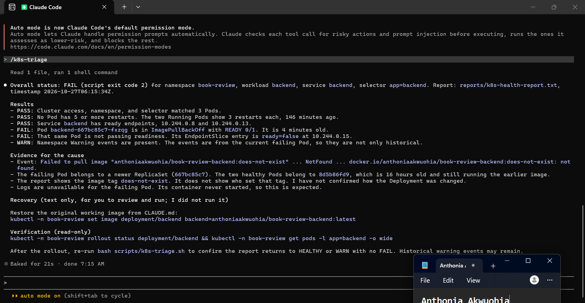

---

#### Screenshot 15 — Saved `incident-failure-report.txt`

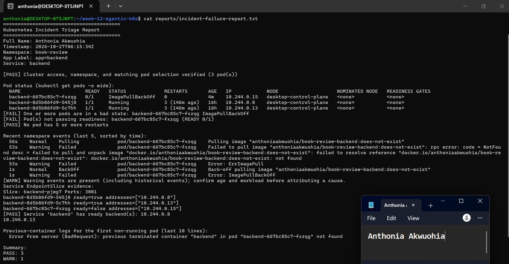

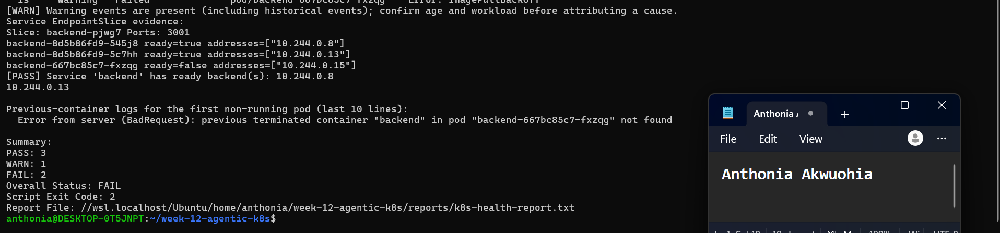

### Notes

**1. Which failure did you choose?**

I chose Option A — Invalid image. I changed the backend Deployment image to anthoniaakwuohia/book-review-backend:does-not-exist to simulate an image-pull failure.

**2. Which checks failed, and what evidence proved it?**

The Pod status and readiness checks failed. Pod backend-667bc85c7-fxzqg entered ImagePullBackOff with READY 0/1. The EndpointSlice also showed its IP, 10.244.0.15, as ready=false. Warning events confirmed that the image tag could not be found. The report recorded 3 PASS, 1 WARN, and 2 FAIL, with exit code 2.

**3. Did Claude execute recovery? Why is that important?**

No. Claude analyzed the evidence and suggested a recovery command for me to execute manually. This preserves human oversight and ensures that recovery actions are reviewed and authorized before changes are made to the cluster.

**4. Why might the Service retain ready backends during the incident?**

The Service retained the two older healthy Pods, 10.244.0.8 and 10.244.0.13, because they remained ready to serve traffic. Kubernetes excluded the unready Pod at 10.244.0.15 from normal Service traffic, helping maintain application availability during the incident.

---

# Task 8 — Recover Manually and Verify

## Goal

Restore the healthy configuration yourself and verify recovery using a second triage report.

### Evidence

#### Screenshot 16 — Recovered Pods and ready Service backends

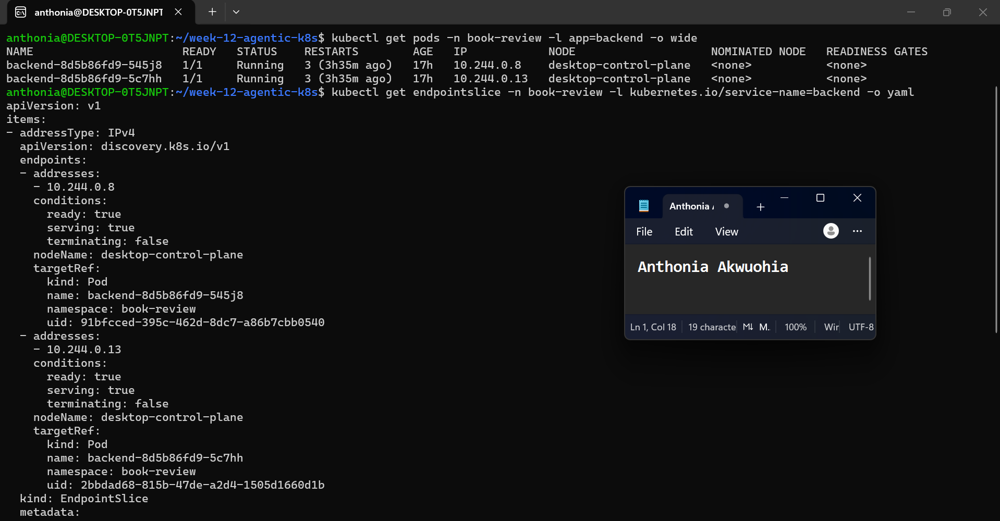

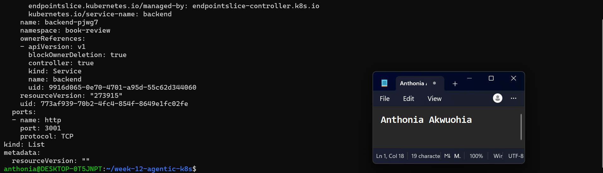

---

#### Screenshot 17 — Recovered `/k8s-triage` analysis

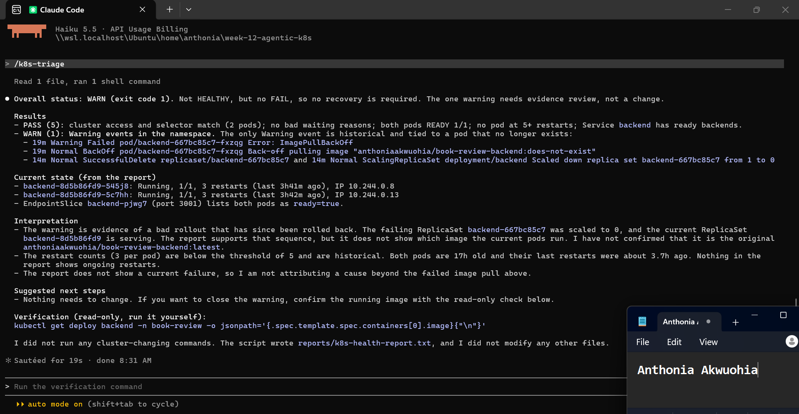

---

#### Screenshot 18 — Reports directory showing failure and recovery reports

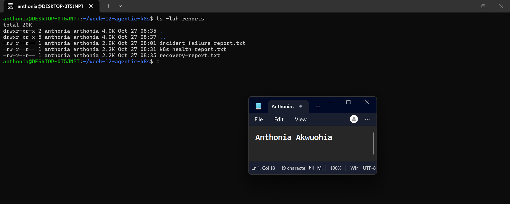

---

#### Screenshot 19 — `incident-summary.md` with all required sections

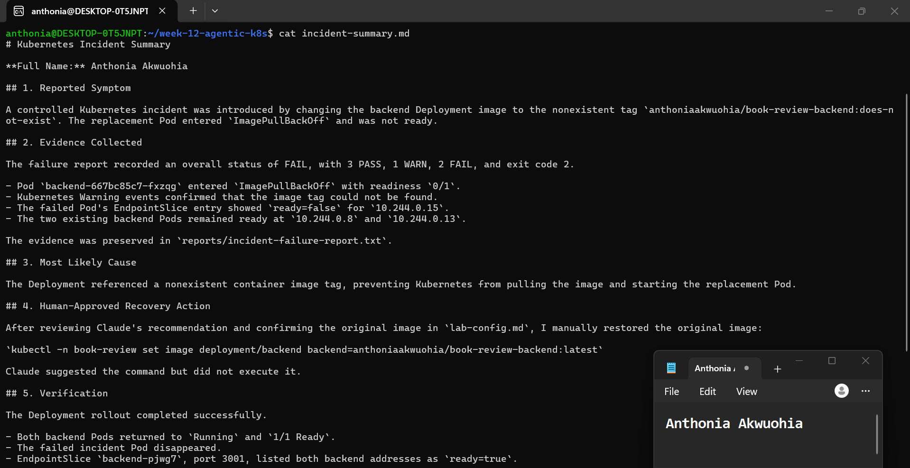

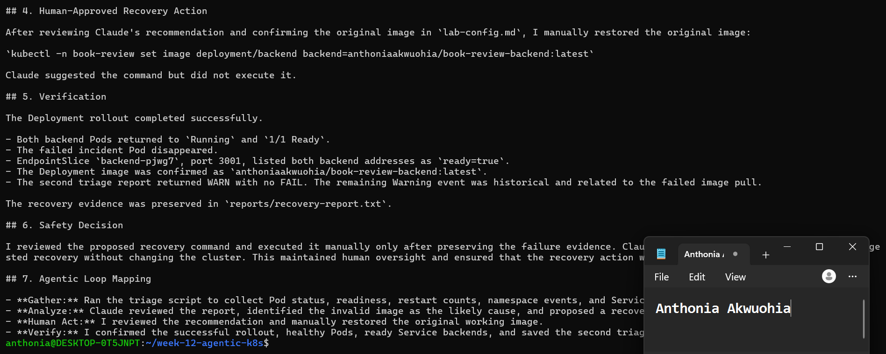

### Notes

**1. What manual recovery action did you execute?**

I manually restored the original working image by updating the backend Deployment to use anthoniaakwuohia/book-review-backend:latest.

**2. What proves the workload recovered?**

The Deployment rollout completed successfully. Both backend Pods returned to Running and 1/1 Ready, the failed incident Pod disappeared, and the EndpointSlice confirmed that both backend addresses were ready=true. The Deployment image was also verified as the original working image.

**3. Why is the second triage run necessary?**

The second triage run verifies the workload after recovery, gathers fresh evidence, and confirms whether the incident has been resolved. It also identifies any remaining warnings that require review.

**4. Why should AI not automatically restart every failing production workload?**

A failure may have different causes, and restarting a workload could cause downtime, data loss, or further disruption. AI should analyze the evidence and recommend an appropriate action, while a human reviews and authorizes changes to maintain safety and control.

### Remaining WARN Results

Explain any WARN results remaining after recovery, or write “None.”

One WARN remained because Kubernetes retained historical Warning events from the failed image-pull incident. These events referenced the old failed Pod, which had disappeared after recovery. Both current Pods were healthy, both Service backends were ready, and the recovery report contained no FAIL. The remaining warning required evidence review, not another recovery action.

---

# Task 9 — Publish Your Kubernetes Incident-Triage Workflow on LinkedIn

## Goal

Share the incident-triage workflow you completed and explain the role of human control.

### Evidence

#### Screenshot 20 — Published LinkedIn post about your Kubernetes incident-triage workflow

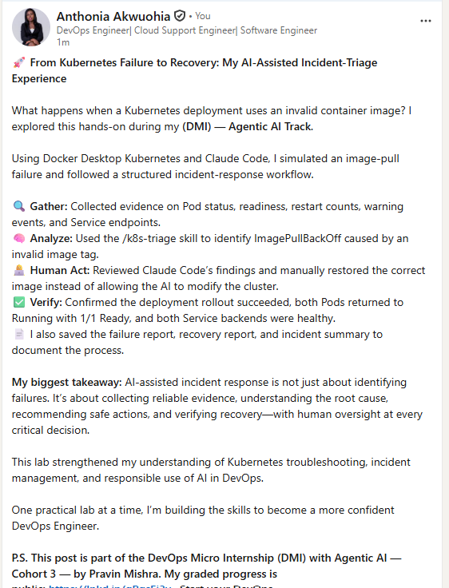

### LinkedIn Post URL

https://www.linkedin.com/posts/anthonia-akwuohia-5b00681b0_devops-kubernetes-agenticai-share-7520754445018734592-G2Uq/?utm_source=share&utm_medium=member_desktop&rcm=ACoAADEhX1QBTHiW-kQPmKjn3MVixQzj4IzJO1Q

---

# Required Project Files

Include these files in your project repository:

- `CLAUDE.md`
- `lab-config.md`
- `scripts/k8s-triage.sh`
- `.claude/skills/k8s-triage/SKILL.md`
- `reports/incident-failure-report.txt`
- `reports/recovery-report.txt`
- `incident-summary.md`

Your `incident-summary.md` must contain:

1. Reported Symptom
2. Evidence Collected
3. Most Likely Cause
4. Human-Approved Recovery Action
5. Verification
6. Safety Decision
7. Agentic Loop Mapping

---

# Final Summary

## Evidence and Cause

Summarize the evidence and the supported cause of the incident.

Add your summary here.

## Manual Recovery

Describe the command or configuration change you performed.

Add your summary here.

## Verification

Explain how the recovery report and Kubernetes outputs confirmed recovery.

Add your summary here.

## Safety Decision

Explain how you kept Claude’s role limited to evidence gathering and analysis.

Add your summary here.

---

# Submission Instructions

- Include all 20 required screenshots under their corresponding Evidence sections.
- Complete all Notes questions in your own words.
- Include the required project files in your linked repository.
- Include your published LinkedIn post URL.
- Use clear, readable screenshots showing relevant commands, configuration, and outputs.
- Display your full name before taking required terminal screenshots.
- Preserve the failure report before recovery.
- Ensure the baseline and recovery reports contain no FAIL results.
- Explain any WARN results remaining after recovery.
- Review reports, logs, configuration records, and screenshots before publishing.
- Do not expose credentials, kubeconfig contents, tokens, certificates, JWT secrets, or confidential account information.

---

# Completion Checklist

- [ ] Confirmed the personal lab context
- [ ] Discovered and recorded application configuration
- [ ] Recorded the original working image
- [ ] Captured healthy Pods and ready Service backends (Screenshot 1)
- [ ] Created the workspace (Screenshot 2)
- [ ] Configured CLAUDE.md (Screenshot 3)
- [ ] Reviewed the five-check triage plan (Screenshot 4)
- [ ] Configured and reviewed the supplied script (Screenshots 5–7)
- [ ] Passed Bash syntax validation and set executable permission (Screenshot 8)
- [ ] Captured a baseline report with no FAIL (Screenshot 9)
- [ ] Captured the correct exit code (Screenshot 10)
- [ ] Configured and invoked `/k8s-triage` (Screenshots 11–12)
- [ ] Simulated one controlled incident manually (Screenshot 13)
- [ ] Reviewed Claude’s failed-state analysis (Screenshot 14)
- [ ] Saved failure evidence before recovery (Screenshot 15)
- [ ] Executed recovery manually and waited for rollout completion
- [ ] Confirmed recovered Pods and ready Service backends (Screenshot 16)
- [ ] Captured recovery analysis with no FAIL (Screenshot 17)
- [ ] Explained any remaining warnings
- [ ] Saved failure and recovery reports (Screenshot 18)
- [ ] Completed the seven-section incident summary (Screenshot 19)
- [ ] Answered all Notes questions
- [ ] Published the LinkedIn post (Screenshot 20)
- [ ] Included the LinkedIn post URL
- [ ] Included all required project files
- [ ] Checked that no sensitive information is exposed

---

## 📌 About DMI & CloudAdvisory

DevOps Micro Internship (DMI) is a project-based DevOps program run by Pravin Mishra (The CloudAdvisory) focused on real-world execution, systems thinking, and career readiness.

It helps learners build strong DevOps foundations with hands-on experience.

---

## 📌 Resources

- 🌐 DMI Official Website: https://dmi.pravinmishra.com?utm_source=github&utm_medium=readme  
- 🎓 University: https://university.pravinmishra.com?utm_source=github&utm_medium=readme  
- 💬 Discord Community: https://discord.pravinmishra.com?utm_source=github&utm_medium=readme  
- 📝 Blog: https://dmi.pravinmishra.com/blog?utm_source=github&utm_medium=readme  
- ▶️ YouTube Playlist: https://www.youtube.com/playlist?list=PLFeSNDtI4Cho  
- 🔗 Pravin Mishra (LinkedIn): https://www.linkedin.com/in/pravin-mishra-aws-trainer/  
- 🏢 CloudAdvisory (LinkedIn): https://www.linkedin.com/company/thecloudadvisory/

---

*This submission is part of DevOps Micro Internship (DMI) — Agentic AI Track.*
